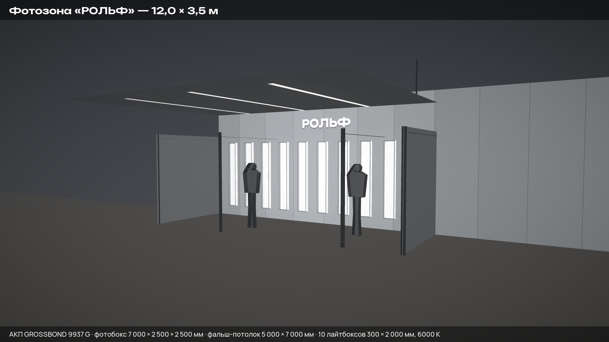
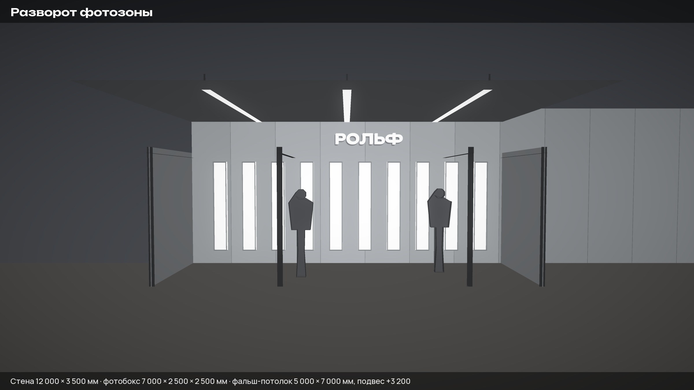
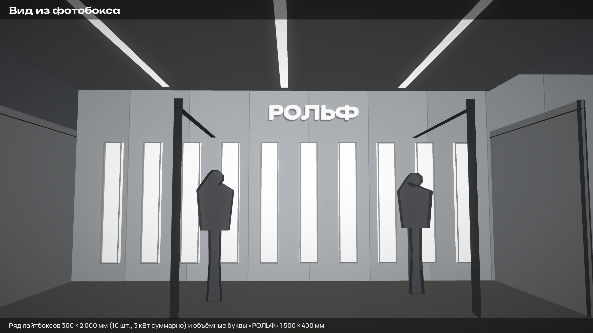
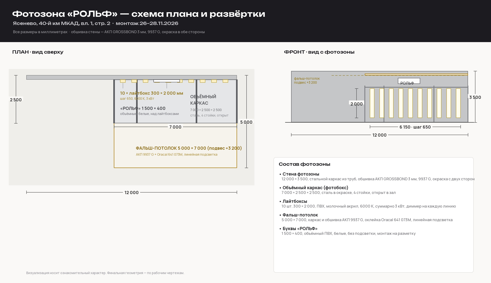

# Фотозона «РОЛЬФ» — коммерческое предложение и ответ на запрос

**Объект:** Московская обл., г. Ясенево, 40-й км МКАД (внешняя сторона), вл. 1, стр. 2
**Мероприятие:** фотозона (запрос от 22.10.2026)
**Требуемая дата:** монтаж завершён до 30.11.2026
**Исполнитель:** SM Production, Москва, Остаповский проезд, д. 9, с. 13, +7 495 799-00-19
**Дата расчёта:** 22.10.2026 · **Действителен до:** 05.11.2026

---

## 1. Цена по каждой позиции

Цены указаны **без НДС**, в рублях. Работаем на **УСН «доходы» 6 %** — итог с налогом **2 671 200 ₽**.
При необходимости счёта с НДС 20 % — итог **3 024 000 ₽** (работаем на общей системе, НДС выделяется).

| № | Позиция | Ед. | Цена, ₽ |
|---|---------|-----|---------:|
| 1 | Рабочие (технические) чертежи, файлы для ЧПУ-фрезеровки и лазерной резки | 1 компл. | 95 000 |
| 2 | Отрисовка дизайна, визуализация, фотопривязки | 1 компл. | 65 000 |
| 3 | Каркас фотозоны объёмный 12000 × 3500 (2500 × 7000 × 2500), стальная рама из труб разного сечения | 1 шт. | 365 000 |
| 4 | Фотозона 12000 × 3500, обшивка с обеих сторон: АКП GROSSBOND, полиэстер, 3 мм, 9937 G — фрезеровка, гибка, сборка | 1 шт. | 456 000 |
| 5 | Буквы «РОЛЬФ», объёмные, ПВХ, без подсветки, 1500 × 400 мм, белые | 1 компл. | 42 000 |
| 6 | Лайтбоксы 300 × 2000 мм, ПВХ, молочный акрил, 6000 К, суммарно 3 кВт, диммер на каждую линию | 10 шт. | 385 000 |
| 7 | Фальш-потолок под линейную подсветку 5000 × 7000 мм: рама из профильной трубы с окраской, обшивка АКП GROSSBOND 3 мм, 9937 G | 1 шт. | 295 000 |
| 8 | Оклейка поверхности фальш-потолка плёнкой Oracal 641 073M (тёмно-серая), 5000 × 7000 мм | 1 шт. | 62 000 |
| 9 | Монтаж на объекте, в т. ч. ночной: разгрузка, монтажные работы, крепёж, тура, расходные материалы, доставка конструкций | 1 компл. | 520 000 |
| 10 | Упаковка и погрузка: короба OSB, стрейч-плёнка, погрузка с учётом увеличенного размера фотозоны | 1 компл. | 245 000 |
| | **ИТОГО (без налога)** | | **2 530 000** |
| | УСН «доходы» 6 % | | 151 800 |
| | **ИТОГО к оплате (УСН 6 %)** | | **2 681 800** |
| | *альтернативно: НДС 20 %* | | *3 036 000* |

Цены фиксируются после утверждения дизайна и не меняются в течение срока действия предложения.

---

## 2. Что входит в каждую позицию

**1. Рабочие чертежи и файлы для ЧПУ — 95 000 ₽**
Конструктивные узлы каркаса фотозоны и фальш-потолка с раскладкой по трубам и спецификацией
металла; развёртки и карты раскроя обшивки АКП (обе стороны + потолок) и плёнки; раскройные
и фрезеровочные карты букв «РОЛЬФ»; электрическая схема лайтбоксов с размещением диммеров;
узлы крепления и подвеса. На выходе: DXF/STEP для фрезеровки и лазерной резки + PDF-комплект
для производства и сборки.

**2. Отрисовка дизайна, визуализация, фотопривязки — 65 000 ₽**
Планировочные раскладки фотозоны и фальш-потолка, 3D-визуализация (2–3 ракурса), посадка
дизайна и фотопривязка на фото площадки и на объёмный каркас, финальные макеты для печати
и оклейки. Один цикл правок включён.

**3. Каркас фотозоны — 365 000 ₽**
Труба профильная 60 × 60 × 3 (несущие стойки и обвязки) и 40 × 40 × 2 (объёмный блок, связи,
подвесы); сварка в цехе с контролем геометрии и плоскостности; шлифовка, грунт, порошковая
окраска (цвет по согласованию с заказчиком); разборный модульный монтаж — 3 секции по 4 м;
комплект крепежа, подвесов и распорок.

**4. Фотозона (обшивка) — 456 000 ₽**
≈ 94 м² АКП GROSSBOND 3 мм, цвет 9937 G (42 м² на сторону + запас 12 % на раскрой и подрезку);
ЧПУ-фрезеровка, отбортовка и гибка, зачистка кромок; сборка на каркасе — клёпки/саморезы,
герметизация швов, силиконовый контур по периметру.

**5. Буквы «РОЛЬФ» — 42 000 ₽**
5 букв высотой 400 мм: лицевая панель — акрил 3 мм белый, борт — ПВХ 2 мм, глубина 60 мм;
ЧПУ-фрезеровка, сборка борта, монтажные пластины под установку на каркас.

**6. Лайтбоксы × 10 — 385 000 ₽**
Корпус из ПВХ 5 мм, рассеиватель — молочный акрил 3 мм; LED 6000 К, 24 В, 300 Вт на ящик
(3 кВт суммарно по 10 линиям); драйверы, диммер 0–10 В / DALI на каждую линию; кабель,
клеммы, суппорты, распределительный щит и автоматы; тест, настройка уровня света и
сдача под ключ.

**7. Фальш-потолок — 295 000 ₽**
Рама из профильной трубы 50 × 50 × 3 с порошковой окраской; обшивка АКП GROSSBOND 3 мм,
9937 G (≈ 39 м²) с бортиком по периметру; подвес на тросах и подвесах к потолку объекта;
выполнение отверстий под линейный свет по вашей схеме.

**8. Оклейка плёнкой Oracal 641 073M — 62 000 ₽**
Плёнка 35 м² с раскроем по месту, подготовка основания (обезжиривание), оклейка, торцевые
подрезки. Оклеивается видимая поверхность потолка; оклейка обратной стороны — по
отдельному запросу, доступ к ней на объекте затруднён.

**9. Монтаж, в том числе ночной — 520 000 ₽**
Доставка конструкций на объект (2 рейса, длинномер 13,5 м + кран); разгрузка и сборка
каркаса; обшивка; установка и подключение лайтбоксов, настройка диммеров; монтаж букв;
подвес фальш-потолка; ночная смена (4 человека, 8 часов); тура и подмости; крепёж, тросы,
болты, анкера; расходные материалы; вынос и уборка мусора.

**10. Упаковка и погрузка — 245 000 ₽**
Разборка конструкций на транспортные модули, упаковка в короба OSB с защитой лицевых
панелей, стрейч-плёнка, крепёж и маркировка, погрузка краном, опись и сопроводительные
документы.

---

## 3. Сроки изготовления и монтажа

**Монтаж к 30.11.2026 возможен.** Плановое завершение — 28.11.2026, резерв на
непредвиденные работы — 29–30.11.2026.

| Этап | Даты | Рабочих дней |
|------|------|--------------:|
| Договор, аванс 50 %, утверждение дизайна и раскладок | 23–26.10 | 2 |
| Рабочие чертежи и файлы для ЧПУ | 27.10 – 06.11 | 8 |
| Каркас: резка, сварка, сборка | 09.11 – 17.11 | 7 |
| Каркас: шлифовка и порошковая окраска | 18.11 – 20.11 | 3 |
| Обшивка фотозоны: раскрой, фрезеровка, гибка | 09.11 – 17.11 | 7 |
| Лайтбоксы: сборка, электрика, тест | 09.11 – 20.11 | 10 |
| Буквы «РОЛЬФ»: фрезеровка, сборка | 16.11 – 20.11 | 5 |
| Фальш-потолок: рама, окраска, обшивка | 09.11 – 19.11 | 9 |
| Оклейка Oracal 641 073M | 20.11 – 23.11 | 2 |
| Финальная сборка, проверка, упаковка, погрузка | 23.11 – 25.11 | 3 |
| Доставка на объект (2 рейса) | 26.11 | 1 |
| Монтаж: дневная смена | 26.11 | 1 |
| Монтаж: ночная смена | 26–27.11 (ночь) | 1 |
| Монтаж: завершение, пуск света, уборка | 27–28.11 | 2 |
| **Резерв** | **29–30.11** | **2** |

Критический путь: дизайн → чертежи и файлы ЧПУ → каркас → окраска → сборка и отгрузка.
Обшивка, лайтбоксы, буквы и фальш-потолок идут параллельно, поэтому запас по срокам
образуется именно на них.

Сроки указаны в рабочих днях, без учёта выходных и праздников: производство работает
в выходные, но сроки поставки материалов (АКП 9937 G, акрил, LED, плёнка Oracal) считаем
по худшему сценарию — 3–7 дней карантина на каждую позицию.

---

## 4. Условия, от которых зависят срок и цена

1. **Утверждение дизайна и раскладок до 26.10.2026** и оплата аванса 50 %. Это узкое место
   графика: каждая неделя задержки дизайна сдвигает монтаж на неделю.
2. **Ночной монтаж** требует согласования с администрацией объекта и режимом доступа на
   площадку в ночное время. Подтвердите окно работ (предполагаем 26.11 с 22:00 до 06:00).
3. **Электрика на объекте**: выделенная линия 380/220 В, 3 кВт на освещение плюс запас на
   технику. Кабель от щита до монтажной точки — по нашей схеме, в объём позиции 9 входит.
4. **Крепление**: подвес фальш-потолка и анкеровка каркаса выполняются по вашей схеме
   основания (бетон/металл/подвесной потолок). Наличие проекта основания или согласования
   ускоряет монтаж.
5. **Материалы**: АКП GROSSBOND 3 мм в цвете 9937 G и плёнка Oracal 641 073M — проверяем
   наличие на складе в день аванса. Замена плёнки на аналог в оттенке «серый матовый»
   без удорожания — по согласованию.
6. **Температура света**: расчёт 6000 К. Вариант 4000 К — обсуждаем с фотографом, замена
   LED и повторный тест линий — без изменения цены, срок +1 рабочий день.
7. **Габариты в трёх измерениях** (12000 × 3500 и 2500 × 7000 × 2500) трактуем как:
   длина фотозоны — 12 000 мм, высота — 3 500 мм, объёмный блок — 7 000 (ширина) ×
   2 500 (глубина) × 2 500 (высота) мм. При другой трактовке пересчитаем стоимость каркаса.
8. **Размер надписи «РОЛЬФ» 1500 × 400 мм** трактуем как ширину × высоту комплекта
   (5 букв, высота букв 400 мм). Уточните, если имелась в виду высота каждой буквы.
9. **Демонтаж после мероприятия** в стоимость не входит — готовы предложить отдельной
   позицией (разбор, упаковка, вывоз ≈ 120 000 ₽) или оставить конструкцию на объекте.

---

## 5. Коммерческие условия

- **Оплата:** аванс 50 % до начала производства, остаток 50 % до отгрузки с площадки.
  Работаем с юр. лицами и ИП, безналичный расчёт, полный комплект закрывающих документов.
- **Налоги:** УСН «доходы» 6 % (по умолчанию) либо счёт с НДС 20 % — по вашему выбору.
- **Гарантия:** 12 месяцев на конструкции и обшивку, 6 месяцев на электрику и свет.
  Гарантия не распространяется на механические повреждения и работы третьих лиц на объекте.
- **Срок действия предложения:** 14 календарных дней с даты расчёта (до 05.11.2026).
- **В цену не входит:** подводка электропитания от здания до щита, согласования и
  разрешения на работы, охрана и пропускной режим объекта, демонтаж и вывоз конструкций.
- **Скидка при отказе от ночного монтажа** (перенос на дневные смены) — 45 000 ₽.
- **Скидка 3 %** при полной предоплате до начала производства.

---

## 6. Визуализация фотозоны

Ниже — предварительные визуализации по вашему ТЗ: стена 12 000 × 3 500 мм, объёмный
каркас 7 000 × 2 500 × 2 500 мм, 10 лайтбоксов 300 × 2 000 мм, фальш-потолок
5 000 × 7 000 мм и объёмные буквы «РОЛЬФ» 1 500 × 400 мм.

Визуализация показывает расположение и пропорции элементов, цвет и уровень света.
Финальная геометрия определяется рабочими чертежами и файлами для ЧПУ (позиция 1).
Отдельно отрисуем посадку на фото площадки, как только получим архив снимков.

---

## 7. Что прислать для старта

1. Утверждённые макеты / логотипы в векторе (AI, PDF, EPS) и подтверждение цвета 9937 G.
2. Схема расположения лайтбоксов на фото-стенде (или разрешение расставить равномерно).
3. Подтверждение температуры света: 6000 К или 4000 К.
4. Схема креплений / тип основания в зоне монтажа.
5. Контакты ответственного на объекте и подтверждение ночного окна работ.
6. Реквизиты для договора и счёта.

---

**Контакты по проекту:** отдел производства SM Production, +7 495 799-00-19,
Москва, Остаповский проезд, д. 9, с. 13. Возможен выезд на замер площадки и показ
производства.
