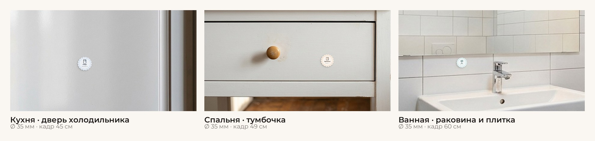

# Наклейки в интерьерах московских квартир

Три кадра: как наклейка Ø 35 мм из набора в 80 слов выглядит на настоящей
поверхности. Не 3D-сцена — фотореалистичный интерьер, на который положены
**настоящие** наклейки из `production/home-stickers-bilingual`.



## Зачем понадобился свой скрипт

Любая нейросеть, если попросить «нарисуй наклейку Fridge на холодильнике»,
напишет «Fndge» и нарисует не тот фестон. Поэтому интерьеры генерируются
**пустыми**, а наклейки накладываются кодом: рисуются из того же вектора,
что уходит в печать, в 1200 dpi, с перспективой, тенью и зерном кадра.

Так на макете оказывается ровно то, что человек получит в конверте.

## Файлы

| Файл | Сюжет | Ширина кадра | Наклейка в кадре |
|---|---|---|---|
| `final/01-kitchen-fridge.jpg` | Кухня, дверь холодильника | 45 см | 110 px · 7,8 % |
| `final/02-bedroom-nightstand.jpg` | Спальня, тумбочка | 49 см | 100 px · 7,1 % |
| `final/03-bathroom-sink.jpg` | Ванная, раковина и плитка | 60 см | 82 px · 5,8 % |
| `final/preview-set.jpg` | Полоса 3 в ряд с подписями | — | превью для беседы |

Исходные пустые интерьеры — в `raw/`, скрипт — `compose.py`.

## Масштаб — главное

Первая версия подбирала размер «на глаз», и наклейка выходила в 3–5 раз
крупнее реальной. Теперь размер считается, а не подбирается:

1. По предмету с известным размером определяется масштаб исходника
   `px_per_cm`: дверь холодильника 60 см ≈ 955 px → 15,9 px/см;
   ящик тумбочки 45 см ≈ 730 px → 16,2 px/см; раковина 60 см ≈ 326 px → 5,4 px/см.
2. Из кропа и `px_per_cm` получается реальная ширина кадра в сантиметрах.
3. Диаметр наклейки в пикселях = `3,5 см / ширина кадра × 1408`.

Поэтому наклейка занимает 6–8 % ширины кадра — столько же, сколько на любой
фотографии, снятой с расстояния 45–60 см. Общий план комнаты для этого не
годится: на нём 35 мм — это 10–20 пикселей, и наклейки физически не видно.
Крупный план — не приём «покрупнее», а единственный честный способ показать
реальный размер.

Пересчёт виден в выводе скрипта: `кадр 49 см · наклейка 100 px = 7.1 % ширины`.

## Как это устроено

1. **Кроп.** Исходник обрезается по пропорции 1408 : 768 и растягивается до
   неё же; скрипт ругается, если пропорции кропа не совпадают.
2. **Рендер.** Наклейка рисуется тем же кодом, что и печатные листы
   (`build_stickers.draw_sticker`), в PDF на страницу размером с наклейку,
   затем растеризуется в **1200 dpi**.
3. **Альфа.** Белый фон вырезается по минимальному каналу, край поджимается
   до 0,4 px — иначе наклейка выглядит приклеенной поверх с белым «облаком».
4. **Перспектива.** Четырёхугольник с перекосом (`taper`) и сжатием по
   вертикали (`sqz`): плоскость видна под углом, круг становится эллипсом.
5. **Тень.** Два слоя: плотная контактная у края и широкая мягкая дальше.
6. **Вписывание в свет.** Наклейка подмешивает локальный цвет поверхности
   (`tint`), чуть теряет резкость (`focus`) и получает фотографическое зерно
   (`add_grain`) — иначе она выглядит как наклейка в редакторе.

## Пересобрать

```bash
python -m venv .venv
.venv/bin/pip install pillow numpy reportlab fonttools pymupdf
.venv/bin/python marketing/home-stickers-interiors/compose.py
```

Сцена — словарь в `SCENES`: файл, кроп, `px_per_cm`, слово, центр в долях кадра.
Кроп задаётся под 1408 : 768 (1,83), иначе кадр растянется.

## Ограничения

- Интерьеры **сгенерированы**, это не фотографии реальных квартир. Если
  материалы пойдут в рекламу — подписать «визуализация», как в остальных
  проектах.
- Наклейки на макетах — реальные: тот же фестон, те же цвета, те же слова.
- Кадр шире ~60 см для этого набора не годится: наклейка становится меньше
  5 % ширины и слово не читается даже в полном размере.
