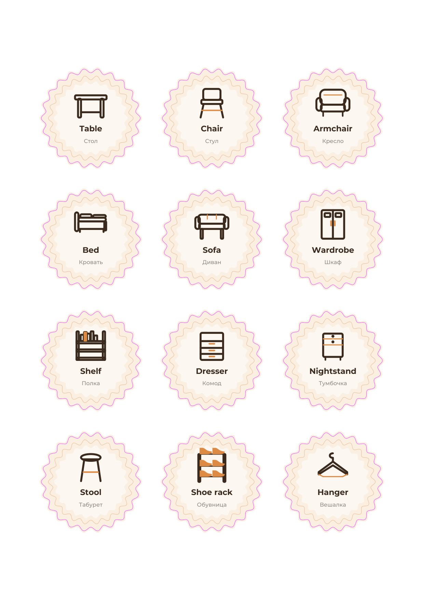

# Обучающие наклейки для дома — EN + RU

80 наклеек на предметы дома. На каждой сверху — **английское слово жирным**, под ним русское. Клеим на сам предмет — ребёнок читает слово там, где стоит вещь.



## Что в PDF

| Страница | Что на ней |
|---|---|
| 1 | Обложка: три примера, инструкция по печати и резке, легенда контура |
| 2–5 | Печатные листы A4: по 20 наклеек, всего 80 |
| 6–9 | Только контуры реза — те же 20 на лист с подписями «RU · EN». Отдать на плоттер отдельно |
| 10 | Слова по комнатам: план расклейки, пары EN → RU и три игры |

Файл: `SM-Production-home-stickers-bilingual.pdf`

## Размеры и материал

- наклейка по контуру реза — **Ø 35 мм** (круг-фестон, 18 лепестков);
- шаг сетки — 45 мм, 4 × 5 на лист A4;
- вылет краски за контур реза — **0,8 мм** (на листе видно как светлый ободок у малиновой линии);
- контур реза — 100 % magenta `#FF00FF`, 0,35 pt (CutContour для плоттера);
- материал: белая виниловая плёнка или самоклеящаяся бумага;
- для кухни и ванной — матовая ламинация, иначе вода и мытьё убьют печать за неделю.

## Как печатать и резать

1. Печать: A4, **100 %**, без «по размеру страницы» — иначе контур не совпадёт с резаком.
2. Ламинация до резки — так проще резать и край не мажется.
3. Рез: по малиновой линии. Вручную — ножницами по фестону, на плоттере — как контур реза CutContour.
4. Наклейка: обезжирить поверхность, прижать от центра к краям, разгладить.
5. Влажные зоны (кухня, ванная) — только с ламинацией.

## Для CorelDRAW

Если наклейки уходят в печать через Corel, берите папку `corel/`:

| Файл | Что это |
|---|---|
| `stickers-sheet-01…04.svg` | по 20 наклеек, **каждая в своей группе**, контуры реза — отдельным слоем сверху |
| `pechat-sheet-XX.pdf` | только графика |
| `rez-sheet-XX.pdf` | только контуры, spot-цвет CutContour |
| `pechat-i-rez-sheet-XX.pdf` | графика + контуры одним файлом |

Подробная инструкция, что делать, если Corel не видит слои: `corel/КАК-ОТКРЫТЬ-В-COREL.md`.
Собрать заново: `.venv/bin/python production/home-stickers-bilingual/export_corel.py`.

## Слова

**Мебель (12):** Table · Стол, Chair · Стул, Armchair · Кресло, Bed · Кровать, Sofa · Диван, Wardrobe · Шкаф, Shelf · Полка, Dresser · Комод, Nightstand · Тумбочка, Stool · Табурет, Shoe rack · Обувница, Hanger · Вешалка

**Техника (12):** Fridge · Холодильник, Stove · Плита, Oven · Духовка, Microwave · Микроволновка, Kettle · Чайник, TV · Телевизор, Computer · Компьютер, Speaker · Колонка, Washing machine · Стиральная машина, Lamp · Лампа, Iron · Утюг, Hairdryer · Фен

**Дом (19):** Window · Окно, Windowsill · Подоконник, Door · Дверь, Curtain · Занавеска, Stairs · Лестница, Rug · Коврик, Basket · Корзина, Plant · Цветок, Light switch · Выключатель, Socket · Розетка, Radiator · Батарея, Floor · Пол, Box · Коробка, Keys · Ключи, Umbrella · Зонт, Bag · Сумка, Broom · Веник, Bucket · Ведро, Picture · Картина

**Ванная (9):** Mirror · Зеркало, Bathtub · Ванна, Sink · Раковина, Shower · Душ, Toilet · Унитаз, Tap · Кран, Toothbrush · Зубная щётка, Soap · Мыло, Towel · Полотенце

**Кухня (10):** Cup · Чашка, Plate · Тарелка, Spoon · Ложка, Pot · Кастрюля, Vase · Ваза, Bottle · Бутылка, Fork · Вилка, Knife · Нож, Frying pan · Сковорода, Bin · Мусорное ведро

**Комната (11):** Clock · Часы, Pillow · Подушка, Jewelry box · Шкатулка, Piggy bank · Копилка, Slippers · Тапочки, Blanket · Одеяло, Alarm clock · Будильник, Remote control · Пульт, Phone · Телефон, Wallet · Кошелёк, Candle · Свеча

**Школа (7):** Backpack · Рюкзак, Pencil case · Пенал, Notebook · Тетрадь, Textbook · Учебник, Book · Книга, Pencil · Карандаш, Ruler · Линейка

## План по комнатам

- **Кухня:** холодильник, плита, духовка, микроволновка, чайник, чашка, тарелка, ложка, вилка, нож, кастрюля, сковорода, бутылка, мусорное ведро, полотенце
- **Гостиная:** стол, стул, табурет, кресло, диван, телевизор, полка, лампа, коврик, часы, цветок, корзина, ваза, пульт, картина, свеча
- **Спальня:** кровать, шкаф, комод, подушка, тумбочка, одеяло, будильник, тапочки
- **Прихожая:** дверь, зеркало, обувница, вешалка, ключи, зонт, сумка, лестница
- **Ванная:** раковина, душ, ванна, унитаз, кран, зубная щётка, мыло, фен, стиральная машина
- **Детская:** рюкзак, пенал, тетрадь, учебник, книга, карандаш, линейка, компьютер, колонка, телефон, шкатулка, копилка
- **Везде:** окно, подоконник, занавеска, выключатель, розетка, батарея, пол, коробка, корзина, веник, ведро, утюг, кошелёк

## Файлы

- `build_stickers.py` — генератор PDF (reportlab, шрифт Montserrat из `banners/anikom-arena-3000x2500-concepts/source/`);
- `words.csv` — те же пары в таблице: `english;russian;category;rooms`;
- `preview-sheet.png` — второй печатный лист для превью.

Сборка из корня репозитория:

```bash
.venv/bin/python production/home-stickers-bilingual/build_stickers.py
```

## Ограничения

- Иконки векторные и схематичные — это обучающие пиктограммы, а не фото предметов.
- Для контраста на тёмной мебели лучше белая плёнка с матовой ламинацией (на тёмном глянце видно отпечатки).
- Контур реза малиновый: на печати он останется тонкой линией, если резать вручную. Для плоттера слой CutContour уже выделен отдельным цветом.
