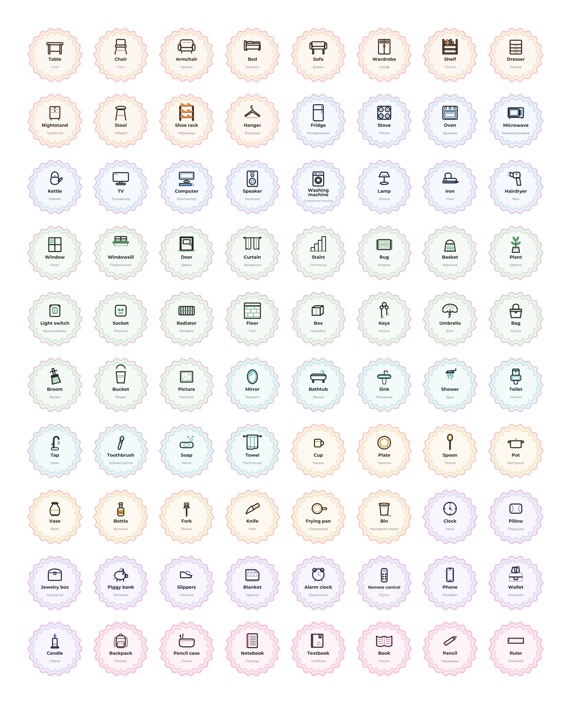

# Все 80 наклеек на одном листе

Готовый файл для типографии: картинки — растром, контур реза — вектором
в spot-цвете CutContour. Один лист вместо четырёх A4.



## Файлы

| Файл | Размер листа | Что внутри | Когда нужен |
|---|---|---|---|
| `all-in-one-art-plus-cut.pdf` | 390 × 480 мм | растр + векторный контур | **основной**: печать и рез одним файлом |
| `all-in-one-art.pdf` | 390 × 480 мм | только растр | если печатают и режут разные подрядчики |
| `all-in-one-cut.pdf` | 390 × 480 мм | только векторные контуры | файл для плоттера, без краски |
| `all-in-one-art-plus-cut-a2.pdf` | 420 × 594 мм (A2) | растр + векторный контур | если просят «стандартный формат» |

У всех четырёх **геометрия совпадает до микрона**: один MediaBox 390 × 480,
одни и те же центры. Печать и рез можно вести разными файлами — они наложатся.

## Что где лежит на листе

- **Сетка 8 × 10**, шаг 45 мм, поля 15 мм;
- 80 наклеек: 35 мм по линии реза, вылет краски +0,8 мм (внешний фестон);
- порядок чтения: слева направо, сверху вниз, как на обычном листе;
- группировка по категориям: мебель → техника → дом → ванная → кухня → комната →
  школа, цвета внутри категории свои.

В A2-версии сетка та же, но отцентрована на стандартном листе: поля получаются
15 мм по бокам и 43 мм сверху/снизу.

## Технические параметры

| Параметр | Значение |
|---|---|
| Растр | **600 dpi**, каждая наклейка отдельным объектом 1063 × 1063 px |
| Формат растра | RGB, без альфы, белый фон запечён |
| Контур реза | векторный путь, spot-цвет `CutContour` (Separation), 0,35 pt |
| Диаметр по резу | 35 мм, фестон 18 лепестков, амплитуда 0,8 мм |
| Текст | переведён в растр вместе с картинкой — шрифты в файле не нужны |
| Шрифты в PDF | отсутствуют (проверено: `text: 0` символов) |

## Почему растр, а не вектор

Печатнику не нужны ваши шрифты и версии Illustrator. Растровая картинка
выглядит одинаково на любой машине, а 600 dpi для наклейки 35 мм — это
семикратный запас по разрешению (типографии просят 300).

Контур реза при этом остаётся настоящей кривой: плоттер читает его как команду
реза, а не как розовую линию на картинке. Если контур «запечь» в растр, резак
его не увидит.

## Как собрать заново

```bash
python -m venv .venv
.venv/bin/pip install reportlab fonttools pymupdf pillow

.venv/bin/python production/home-stickers-bilingual/all_in_one.py
.venv/bin/python production/home-stickers-bilingual/all_in_one.py --page a2
```

Параметры: `--cols`, `--rows`, `--dpi` (по умолчанию 600), `--page`
(`tight` — по размеру сетки, `a2` — 420 × 594 мм, `a3plus` — 329 × 483 мм).

Скрипт переиспользует отрисовку из `build_stickers.py`: те же иконки, цвета
и формула подгонки подписей. Поэтому новый лист не расходится с уже
существующими A4-листами.

## Проверка перед отправкой

```bash
# контур — вектор, spot-цвет, растр — 600 dpi
.venv/bin/python - <<'EOF'
import pymupdf
d = pymupdf.open("production/home-stickers-bilingual/one-sheet/all-in-one-art-plus-cut.pdf")
p = d[0]
print("растр:", len(p.get_images()), "| векторов:", len(p.get_drawings()))
print("CutContour:", any("CutContour" in d.xref_object(i, compressed=False)
                         for i in range(1, d.xref_length())
                         if d.xref_object(i, compressed=False).find("Separation") >= 0))
EOF
```

Ожидаемо: `растр: 80 | векторов: 80`, `CutContour: True`.

## Чего нельзя

- Печатать «по размеру страницы» — только 100 %. Иначе контур уедет
  относительно краски, и резак обрежет мимо.
- Менять размер листа вручную в редакторе: контур и картинка разойдутся.
  Нужен другой формат — пересоберите скриптом.
- Отдавать `all-in-one-cut.pdf` как файл для печати: там нет краски,
  только линии.
