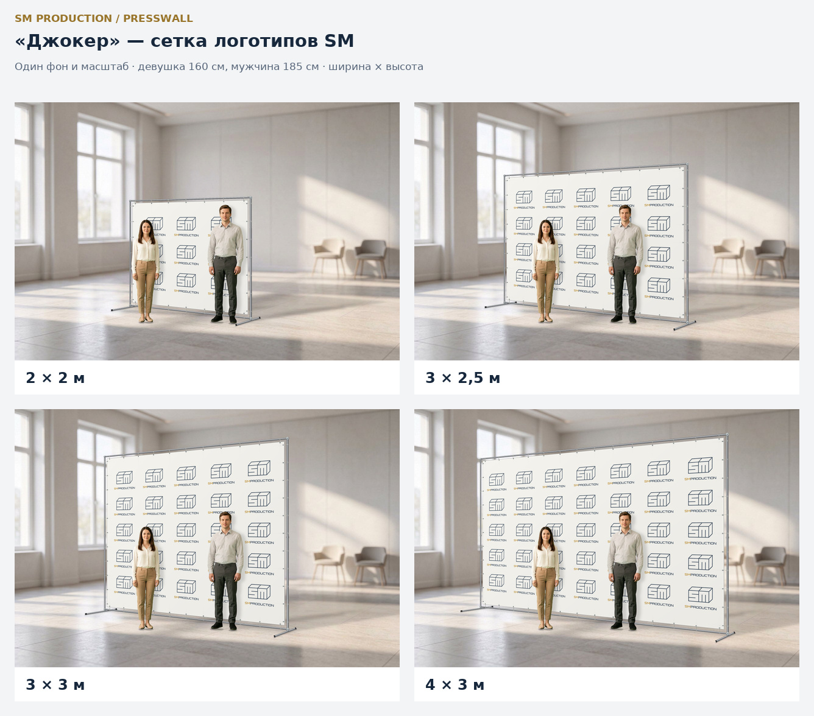

# SM Production — PressWall «Джокер», четыре размера для каталога

Четыре готовых товарных изображения открытого трубного каркаса **«Джокер»** по предоставленному фото конструкции **3 × 3 м**.

**Обновлённый дизайн PressWall:** светлое полотно с регулярной сеткой логотипов SM. Крупный центральный логотип и тёмный геометрический принт заменены только на баннере; помещение, каркас, крепления, ножки и люди сохранены.

Продолжение единой каталожной серии: тот же светлый интерьер, камера, масштаб и та же пара — **девушка 160 см** и **мужчина 185 см**. У всех карточек один ракурс; меняются только габариты конструкции.

**Размеры: ширина × высота внешнего каркаса, в метрах.** Каждое изображение — **1264 × 848 px**, без индивидуального приближения или обрезки под размер изделия.

## Посмотреть и скачать

- [Сравнение всех четырёх размеров](sm-production-joker-size-comparison.jpg)
- [Скачать четыре JPEG одним архивом](sm-production-joker-presswall-jpg.zip)
- [Полный архив — PNG, JPEG, WebP](sm-production-joker-catalog.zip)
- [Предоставленный референс «Джокер» 3 × 3 м](references/joker-3x3-user-reference.jpg)



## Отдельные изображения для карточек товаров

| Размер каркаса | JPEG | WebP для сайта | PNG без потерь |
| --- | --- | --- | --- |
| 2 × 2 м | [Открыть](sm-production-joker-2x2-people.jpg) | [Открыть](sm-production-joker-2x2-people.webp) | [Открыть](sm-production-joker-2x2-people.png) |
| 3 × 2,5 м | [Открыть](sm-production-joker-3x2p5-people.jpg) | [Открыть](sm-production-joker-3x2p5-people.webp) | [Открыть](sm-production-joker-3x2p5-people.png) |
| 3 × 3 м | [Открыть](sm-production-joker-3x3-people.jpg) | [Открыть](sm-production-joker-3x3-people.webp) | [Открыть](sm-production-joker-3x3-people.png) |
| 4 × 3 м | [Открыть](sm-production-joker-4x3-people.jpg) | [Открыть](sm-production-joker-4x3-people.webp) | [Открыть](sm-production-joker-4x3-people.png) |

На отдельных карточках нет стрелок, размерных линий и подписей: размеры указаны в именах файлов, таблице и общем сравнительном листе.

## Особенности конструкции по референсу

- **Открытые круглые металлические трубы** по периметру, с небольшими соединительными узлами.
- **Натяжное полотно внутри рамы**, а не жёсткий закрытый короб или брус-баннер с глубоким торцом.
- **Видимый зазор** между краем полотна и трубами.
- **Люверсы и отдельные светлые крепления** по всем четырём сторонам; шаг сохраняется сопоставимым при изменении размера.
- **Две поперечные опорные ножки** с тёмными торцевыми заглушками, без подиума и закрытого основания.
- **Светлый PressWall с сеткой SM:** тёмно-синяя кубическая монограмма и надпись SM PRODUCTION с золотистым акцентом. Контуры взяты из ранее утверждённого логотипа, без новой генерации или растягивания по отдельным осям. Мелкий слоган не повторяется, чтобы не создавать нечитаемую строку.
- **Одинаковый физический размер логотипа во всех карточках:** ширина 40 см, шаг сетки 55 см по горизонтали и 49 см по вертикали. Сетка 3 × 3 на конструкции 2 × 2 м; 5 × 4 на 3 × 2,5 м; 5 × 5 на 3 × 3 м; 7 × 5 на 4 × 3 м. Это макет принта для визуализации, не производственная раскладка.

Из предоставленной фотографии взяты тип конструкции, её характерные детали и размер-эталон 3 × 3 м. Плитка, лестница, кабели и съёмочное оборудование из референса не переносятся в товарную карточку: для единства каталога сохранён ранее утверждённый светлый фон.

## Масштаб и проверки

- Камера и опорная точка на полу общие с [серией брус-баннеров](../presswalls-sizes/README.md).
- Пара людей повторно использована из [серии с людьми](../presswalls-with-people/README.md) без изменения лиц, одежды, роста, поз или положения между кадрами.
- Изделия не растягиваются до одинакового размера карточки: 2 × 2 м остаётся визуально меньше 4 × 3 м.
- **557 019 общих пикселей фона** идентичны во всех четырёх PNG.
- **45 248 непрозрачных пикселей фигур** совпадают с прежней серией и во всех новых кадрах.
- Проверяются размеры файлов, проекция внешней рамы, отсутствие обрезанных ножек и соответствие четырём запрошенным типоразмерам.
- Дополнительно выполнено попиксельное сравнение с предыдущим дизайном (`2a5939238402902c74297051cac9df745d70aea8`): изменения ограничены полотном и его сглаженным краем. Фон, внешний каркас, ножки и непрозрачные пиксели людей не изменены.
- Полный архив содержит 12 готовых изображений: четыре размера в трёх форматах, сравнительный лист и данные серии. Отдельный JPEG-архив содержит ровно четыре готовые картинки; целостность обоих ZIP проверена.

Размеры 2 × 2, 3 × 2,5, 3 × 3 и 4 × 3 м относятся к **внешнему каркасу**. Само полотно немного меньше из-за зазора для креплений. Диаметр трубы, длина опор, шаг люверсов и мелкие узлы приняты визуально по референсу, а не по производственному обмеру. Это рекламные изображения, не рабочие чертежи.

## Использование на сайте

Сохранять одинаковое соотношение сторон **1264 / 848** и полный кадр. Не обрезать каждое изделие отдельно до его границ и не применять индивидуальное автоприближение: это нарушит наглядность масштаба. Рекомендуется `object-fit: contain`.

Действующие страницы сайта и серии брус-баннеров не изменены.

## Исходники и повторная сборка

- `references/joker-3x3-user-reference.jpg` — исходное предоставленное фото.
- `assets/common-background-check-mask.png` — общая неизменная область фона.
- `assets/sm-logo-presswall-navy-gold.png` — прозрачный логотип для светлого полотна, подготовленный из утверждённого изображения монограммы и надписи.
- `manifest.json` — размеры, проекция, параметры каркаса, рост людей и имена файлов.
- `scripts/render_joker_catalog.py` — воспроизводимая сборка четырёх размеров из сохранённых исходников без новой генерации людей или помещения.
- Общие фон, исходный логотип и прозрачный слой людей берутся из соседних каталогов `presswalls-sizes` и `presswalls-with-people`. Редизайн не перегенерирует помещение, конструкцию или людей; меняется только печатный рисунок полотна.

```bash
python -m pip install -r visualizations/catalog/joker-sizes/requirements.txt
python visualizations/catalog/joker-sizes/scripts/render_joker_catalog.py
python visualizations/catalog/joker-sizes/scripts/render_joker_catalog.py --check
```
