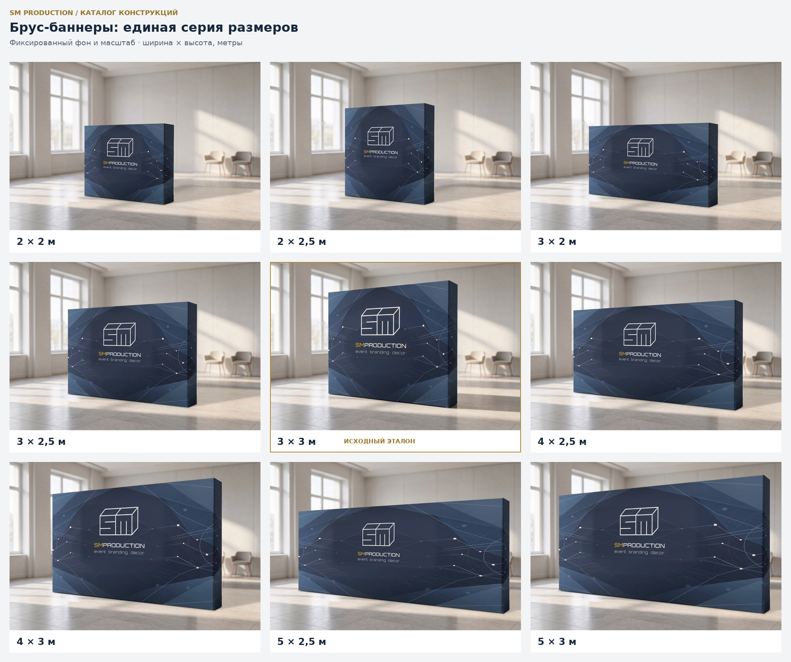

# SM Production — каталог размеров брус-баннеров

Восемь рекламных изображений на базе предоставленного кадра с конструкцией **3 × 3 м**.

**Размеры читаются как ширина × высота, в метрах.** Все самостоятельные изображения — **1264 × 848 px**, с одинаковым кадрированием, без искусственного увеличения разрешения.

## Посмотреть и скачать

- [Сравнительный лист: все восемь размеров и исходный эталон 3 × 3](sm-production-size-comparison.jpg)
- [Скачать всю серию ZIP: PNG, JPEG, WebP](sm-production-presswalls-catalog.zip)
- [Исходное изображение 3 × 3 м](references/sm-production-3x3-original.jpg)



## Изображения для карточек каталога

На отдельных изображениях нет подписей размеров, рамок или стрелок: их можно разместить в интерфейсе карточки товара. Подписи добавлены только на сравнительном листе.

| Ширина × высота | JPEG | WebP для сайта | PNG без потерь |
| --- | --- | --- | --- |
| 2 × 2 м | [Открыть](sm-production-presswall-2x2.jpg) | [Открыть](sm-production-presswall-2x2.webp) | [Открыть](sm-production-presswall-2x2.png) |
| 2 × 2,5 м | [Открыть](sm-production-presswall-2x2p5.jpg) | [Открыть](sm-production-presswall-2x2p5.webp) | [Открыть](sm-production-presswall-2x2p5.png) |
| 3 × 2 м | [Открыть](sm-production-presswall-3x2.jpg) | [Открыть](sm-production-presswall-3x2.webp) | [Открыть](sm-production-presswall-3x2.png) |
| 3 × 2,5 м | [Открыть](sm-production-presswall-3x2p5.jpg) | [Открыть](sm-production-presswall-3x2p5.webp) | [Открыть](sm-production-presswall-3x2p5.png) |
| 4 × 2,5 м | [Открыть](sm-production-presswall-4x2p5.jpg) | [Открыть](sm-production-presswall-4x2p5.webp) | [Открыть](sm-production-presswall-4x2p5.png) |
| 4 × 3 м | [Открыть](sm-production-presswall-4x3.jpg) | [Открыть](sm-production-presswall-4x3.webp) | [Открыть](sm-production-presswall-4x3.png) |
| 5 × 2,5 м | [Открыть](sm-production-presswall-5x2p5.jpg) | [Открыть](sm-production-presswall-5x2p5.webp) | [Открыть](sm-production-presswall-5x2p5.png) |
| 5 × 3 м | [Открыть](sm-production-presswall-5x3.jpg) | [Открыть](sm-production-presswall-5x3.webp) | [Открыть](sm-production-presswall-5x3.png) |

## Как сохранено единство серии

- Одна общая подложка помещения: окна, кресла, стыки пола и освещение не генерируются заново для каждого размера.
- Области комнаты, которые закрывала исходная конструкция 3 × 3 м, восстановлены **один раз** на общей подложке. За пределами локальной маски восстановления сохранены пиксели исходного кадра.
- Одна проектная камера и одна опорная точка на полу. Каждый размер строится в общей системе координат, привязанной к исходным 3 × 3 м. Нет отдельного приближения камеры или автоматического увеличения маленького изделия до размера большого.
- Изменяются ширина и высота изделия, его перекрытие фона и собственная тень; направление света единое.
- Брендинг выделен из предоставленного образца. Монограмма, надпись SM PRODUCTION и строка `event branding decor` масштабируются пропорционально, без растяжения букв по ширине. Декоративная графика отдельно адаптирована к прямоугольному формату.
- Глубина бокового торца принята одинаковой для всей серии и визуально согласована с образцом. Это рекламная визуализация, а не обмер помещения или производственный чертёж.

### Проверка фона

Для PNG автоматически проверяется совпадение с общей подложкой вне конструкции и её тени. **416 709 общих пикселей фона идентичны во всех восьми PNG.** Дополнительно при рендере проверяется каждый кадр вне его индивидуальной области изменений.

JPEG и WebP — сжатые копии тех же изображений; для попиксельного сравнения следует использовать PNG.

## Размещение на сайте

Использовать один размер карточек и одинаковое соотношение сторон. Не обрезать изображения отдельно под каждое изделие и не применять автоприближение к границам конструкции — иначе потеряется сопоставимость масштаба.

```css
.catalog-presswall-image {
  display: block;
  width: 100%;
  height: auto;
  aspect-ratio: 1264 / 848;
  object-fit: contain;
}
```

Страницы и действующие изображения сайта в рамках этой задачи не изменены: серия подготовлена отдельно для каталога.

## Исходники и воспроизведение

- `references/sm-production-3x3-original.jpg` — предоставленное изображение-эталон.
- `assets/background-locked.png` — общая подложка для всех размеров.
- `assets/reference-removal-mask.png` — локальная область восстановления скрытой комнаты и удаления старой тени.
- `assets/print-pattern-clean.png` — очищенная декоративная графика без старого отпечатка логотипа.
- `assets/branding-extracted.png` — бренд-блок на прозрачном фоне, выделенный из образца.
- `assets/common-background-check-mask.png` — белым отмечены общие неизменные пиксели фона.
- `manifest.json` — размеры, имена файлов, проекция и координаты лицевых панелей.
- `scripts/render_catalog.py` — воспроизводимая компоновка серии из сохранённых исходников; повторная генерация изображений ИИ не требуется.

```bash
python -m pip install -r visualizations/catalog/presswalls-sizes/requirements.txt
python visualizations/catalog/presswalls-sizes/scripts/render_catalog.py
python visualizations/catalog/presswalls-sizes/scripts/render_catalog.py --check
```
