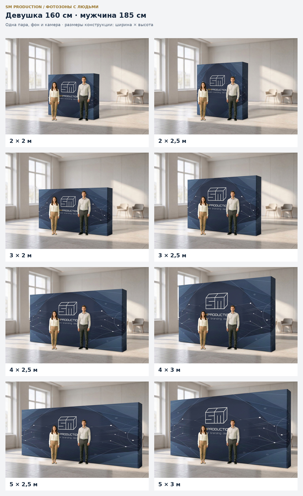

# SM Production — восемь размеров фотозон с людьми

Готовая дополнительная серия к [одобренным изображениям без людей](../presswalls-sizes/README.md).

Во всех восьми кадрах **одна и та же девушка ростом 160 см** и **один и тот же мужчина ростом 185 см**. Люди стоят перед конструкцией, а их масштаб и положение не меняются при смене размера фотозоны. Девушка в обуви без каблуков.

**Размеры конструкции: ширина × высота, метры.** Формат всех кадров — **1264 × 848 px**, как у исходной серии.

## Посмотреть и скачать

- [Общий сравнительный лист восьми размеров](sm-production-people-size-comparison.jpg)
- [Архив всех восьми изображений — PNG, JPEG и WebP](sm-production-presswalls-with-people.zip)



## Отдельные готовые изображения

| Размер конструкции | JPEG | WebP для сайта | PNG без потерь |
| --- | --- | --- | --- |
| 2 × 2 м | [Открыть](sm-production-presswall-2x2-people.jpg) | [Открыть](sm-production-presswall-2x2-people.webp) | [Открыть](sm-production-presswall-2x2-people.png) |
| 2 × 2,5 м | [Открыть](sm-production-presswall-2x2p5-people.jpg) | [Открыть](sm-production-presswall-2x2p5-people.webp) | [Открыть](sm-production-presswall-2x2p5-people.png) |
| 3 × 2 м | [Открыть](sm-production-presswall-3x2-people.jpg) | [Открыть](sm-production-presswall-3x2-people.webp) | [Открыть](sm-production-presswall-3x2-people.png) |
| 3 × 2,5 м | [Открыть](sm-production-presswall-3x2p5-people.jpg) | [Открыть](sm-production-presswall-3x2p5-people.webp) | [Открыть](sm-production-presswall-3x2p5-people.png) |
| 4 × 2,5 м | [Открыть](sm-production-presswall-4x2p5-people.jpg) | [Открыть](sm-production-presswall-4x2p5-people.webp) | [Открыть](sm-production-presswall-4x2p5-people.png) |
| 4 × 3 м | [Открыть](sm-production-presswall-4x3-people.jpg) | [Открыть](sm-production-presswall-4x3-people.webp) | [Открыть](sm-production-presswall-4x3-people.png) |
| 5 × 2,5 м | [Открыть](sm-production-presswall-5x2p5-people.jpg) | [Открыть](sm-production-presswall-5x2p5-people.webp) | [Открыть](sm-production-presswall-5x2p5-people.png) |
| 5 × 3 м | [Открыть](sm-production-presswall-5x3-people.jpg) | [Открыть](sm-production-presswall-5x3-people.webp) | [Открыть](sm-production-presswall-5x3-people.png) |

На отдельных изображениях нет подписей роста, размеров и стрелок — они готовы для карточек каталога. Рост указан в заголовке общего листа и в данных серии.

## Единство масштаба и фона

- Использованы готовые кадры предыдущей серии: фон, камера, габариты изделий и брендинг не перегенерированы.
- Одна пара вымышленных взрослых персонажей подготовлена отдельными прозрачными слоями и повторно использована во всех восьми изображениях. Лица, одежда, позы и размер фигур одинаковы.
- Рост **1,60 м** и **1,85 м** задан от макушки до уровня опоры в той же проектной сцене, где исходная конструкция имеет размер **3 × 3 м**. Размеры людей не подгоняются под высоту очередного баннера.
- Фигуры масштабируются пропорционально. Положение головы и опора на полу рассчитаны существующей проектной камерой; пара находится перед плоскостью конструкции.
- Добавлены небольшие контактные тени под обувью и мягкие тени с тем же направлением дневного света слева. Тени на полу и на лицевой панели разделены, чтобы не затенять посторонние части помещения.
- Люди естественно перекрывают ту часть печати, перед которой стоят, как на фотографии у настоящей фотозоны. Центральная монограмма остаётся между фигурами.
- Предыдущие восемь изображений без людей сохранены без изменений. Страницы сайта в рамках этой задачи не менялись.

## Проверки

Скрипт проверяет:

1. Наличие восьми размеров и 24 файлов трёх форматов, у всех 1264 × 848 px.
2. Неизменность исходных PNG серии без людей по SHA-256.
3. Попиксельную неизменность кадра вне фигур и их локальных теней.
4. Идентичность непрозрачных частей фигур на всех восьми PNG.
5. Соответствие макушки и опоры каждой фигуры заданным 160/185 см в проектной камере и отсутствие непропорционального растяжения людей.
6. Целостность ZIP-архива.

Рекламные изображения иллюстрируют масштаб на основе предоставленного кадра, а не заменяют обмер помещения или рабочие чертежи.

## Файлы для следующих серий

- `assets/woman-160cm.png`, `assets/man-185cm.png` — персонажи на прозрачном фоне; можно повторно использовать для конструкций тритикс с тем же помещением и камерой.
- `assets/people-assets.json` — исходные точки макушки и опоры персонажей.
- `assets/people-layer-160-185.png` — общий прозрачный слой пары в размере каталожного кадра.
- `assets/people-floor-shadow.png`, `assets/people-wall-shadow.png` — раздельные маски теней.
- `assets/series-people-edit-mask.png` — общая локальная область изменений относительно серии без людей.
- `manifest.json` — параметры людей, проекция, размеры конструкций и имена файлов.
- `scripts/render_people_catalog.py` — повторная сборка и проверки без новой генерации людей.

```bash
python -m pip install -r visualizations/catalog/presswalls-with-people/requirements.txt
python visualizations/catalog/presswalls-with-people/scripts/render_people_catalog.py
python visualizations/catalog/presswalls-with-people/scripts/render_people_catalog.py --check
```

Для сохранения наглядного масштаба на сайте использовать полный кадр с одинаковыми пропорциями карточек, без отдельного приближения к каждой конструкции (`object-fit: contain`).
