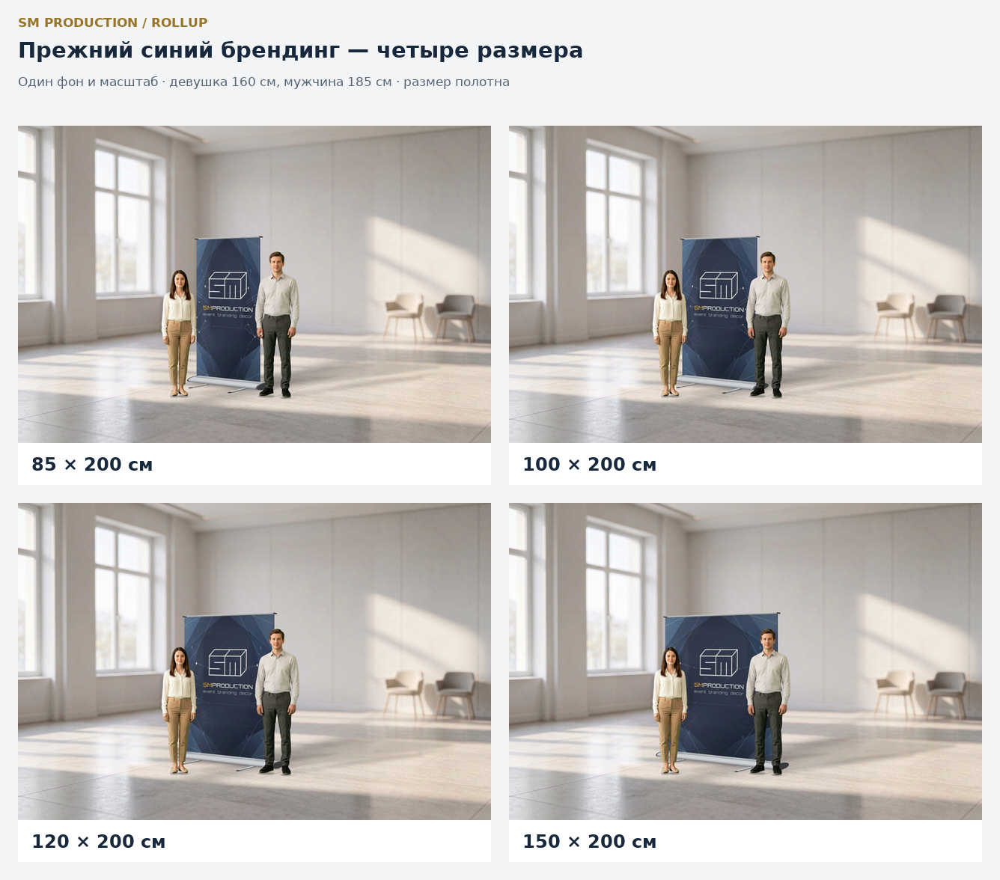

# SM Production — RollUp с прежним синим брендингом

Четыре RollUp с **тёмно-синим геометрическим фоном, одним крупным бело-золотистым логотипом SM Production и подписью event branding decor**. Использованы те же сохранённые фирменные элементы, что в синей серии брус-баннеров, а не светлая сетка повторяющихся логотипов.

Форматы видимого полотна: **85 × 200, 100 × 200, 120 × 200 и 150 × 200 см**, ширина × высота.

Из [ранее подготовленных RollUp](../rollup-sizes/README.md) без изменений сохранены интерьер, камера, конструкция кассеты, опоры, размер полотна и люди: **девушка 160 см и мужчина 185 см**. Каждая картинка — **1264 × 848 px**, без индивидуального приближения или обрезки. Светлая версия осталась в своей папке и не перезаписана.

## Посмотреть и скачать

- [Сравнение четырёх размеров](sm-production-rollup-blue-size-comparison.jpg)
- [Четыре готовых JPEG одним архивом](sm-production-rollup-blue-jpg.zip)
- [Полный архив PNG + JPEG + WebP](sm-production-rollup-blue-catalog.zip)



## Отдельные изображения

| Видимое полотно | JPEG | WebP для сайта | PNG без потерь |
| --- | --- | --- | --- |
| 85 × 200 см | [Открыть](sm-production-rollup-85x200-blue-people.jpg) | [Открыть](sm-production-rollup-85x200-blue-people.webp) | [Открыть](sm-production-rollup-85x200-blue-people.png) |
| 100 × 200 см | [Открыть](sm-production-rollup-100x200-blue-people.jpg) | [Открыть](sm-production-rollup-100x200-blue-people.webp) | [Открыть](sm-production-rollup-100x200-blue-people.png) |
| 120 × 200 см | [Открыть](sm-production-rollup-120x200-blue-people.jpg) | [Открыть](sm-production-rollup-120x200-blue-people.webp) | [Открыть](sm-production-rollup-120x200-blue-people.png) |
| 150 × 200 см | [Открыть](sm-production-rollup-150x200-blue-people.jpg) | [Открыть](sm-production-rollup-150x200-blue-people.webp) | [Открыть](sm-production-rollup-150x200-blue-people.png) |

Отдельные изображения не содержат размерных линий, стрелок или подписей поверх фотографии. Размеры указаны в именах файлов, таблице, сравнительном листе и манифесте.

## Что изменено

- Заменена **только печать на полотне**: вместо светлого повторяющегося паттерна — прежняя синяя геометрическая графика и крупный исходный бело-золотистый логотип.
- Логотип вместе с надписью и слоганом взят из утверждённой серии, без перерисовки, смены шрифта и непропорционального растягивания. Его ширина — 70 см во всех четырёх вариантах.
- Декоративный синий рисунок адаптирован к формату полотна отдельно от логотипа.
- Низкая алюминиевая кассета, две плоские опоры, задняя стойка и верхняя зажимная планка повторно отрисованы тем же исходным алгоритмом, в тех же координатах. Нет боковой рамы, труб по периметру и люверсов.

## Проверки

- **893 512 общих пикселей помещения** совпадают с сохранённым фоном во всех PNG.
- **45 248 непрозрачных пикселей людей** идентичны исходному слою и светлой версии.
- Попиксельное сравнение со светлыми RollUp проверяет, что изменения не выходят за полотно и его сглаженный край: фон, кассета, опоры и люди не меняются.
- Проекция полотна и геометрия конструкции сопоставляются с исходным манифестом. Нет индивидуального зума или изменения масштаба под ширину RollUp.
- Проверяются все 12 экспортов, контрольные суммы исходных изображений и сборщика, содержимое и CRC обоих ZIP.

Форматы относятся к **видимому полотну**, а не к наружному габариту кассеты или готовому файлу для печати. Конструкция типовая и иллюстративная; модель поставщика, рабочую ширину, запас полотна в механизме, вылеты, наличие и комплектацию нужно подтвердить отдельно. Это рекламные визуализации, не производственные чертежи.

## Использование на сайте

Показывать полный кадр с одинаковыми пропорциями **1264 / 848**, рекомендуется `object-fit: contain`. Не обрезать разные ширины до одинакового заполнения карточки.

Сайт, PDF-инструкция, светлые RollUp, брус-баннеры и серия «Джокер» не изменены.

## Исходники и повторная сборка

- `scripts/render_rollup_blue_catalog.py` — сборка синего варианта и проверка области изменений.
- `../rollup-sizes/scripts/render_rollup_catalog.py` — повторно используемый сборщик неизменной конструкции, камеры и освещения.
- `../presswalls-sizes/assets/print-pattern-clean.png` — прежний синий геометрический фон печати.
- `../presswalls-sizes/assets/branding-extracted.png` — исходный бело-золотистый логотип с надписью и слоганом.
- `assets/common-background-check-mask.png` — общая неизменная область помещения.
- `manifest.json` — размеры, геометрия, расположение логотипа и контрольные суммы исходников.

```bash
python -m pip install -r visualizations/catalog/rollup-sizes-blue/requirements.txt
python visualizations/catalog/rollup-sizes-blue/scripts/render_rollup_blue_catalog.py
python visualizations/catalog/rollup-sizes-blue/scripts/render_rollup_blue_catalog.py --check
```
