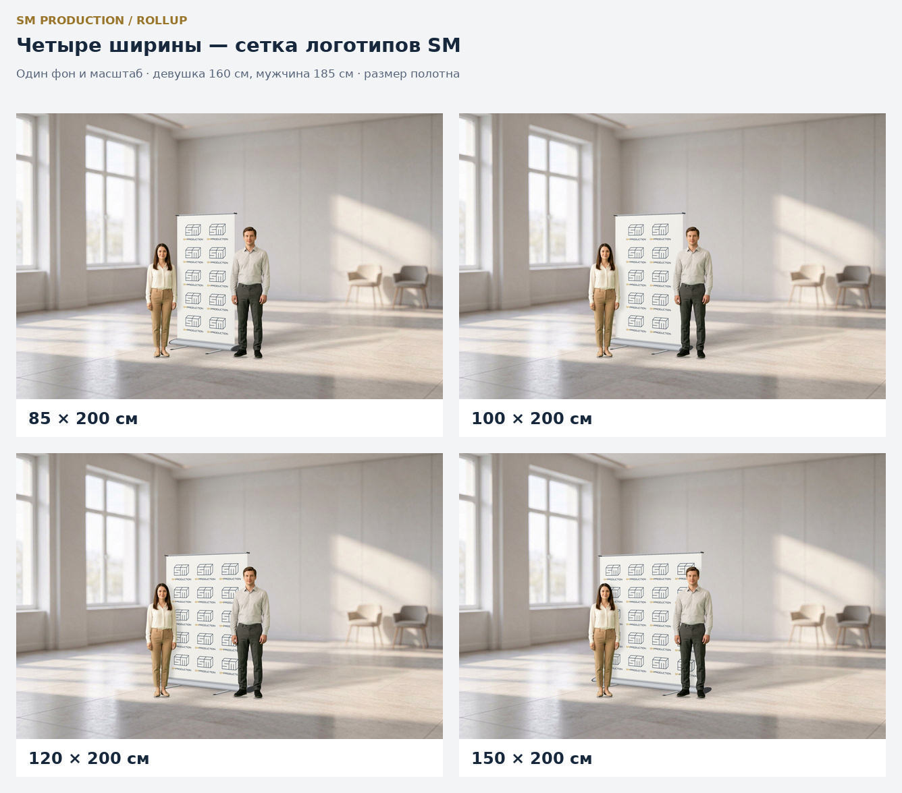

# SM Production — RollUp, четыре размера с сеткой логотипов SM

Четыре каталожные визуализации RollUp в том же стиле, что [обновлённые PressWall «Джокер»](../joker-sizes/README.md): **светлое полотно и повторяющаяся сетка тёмно-синих логотипов SM с золотистым акцентом**.

Использованы четыре формата из [плана ассортимента](../../../site_content/05_nashi-tseny-st340c/README.md): **85 × 200, 100 × 200, 120 × 200 и 150 × 200 см**.

**Порядок размеров — ширина × высота видимого полотна, в сантиметрах.** Это не габарит кассеты и не готовая развёртка для печати. Конкретную модель RollUp, рабочую ширину, запас полотна внутри механизма и вылеты нужно подтвердить перед изготовлением.

Все карточки — **1264 × 848 px**, один интерьер, одна камера, одна опорная точка и та же пара людей: **девушка 160 см, мужчина 185 см**. Без индивидуального приближения, кадрирования или изменения масштаба людей.

## Посмотреть и скачать

- [Сравнить четыре размера](sm-production-rollup-size-comparison.jpg)
- [Скачать ровно четыре JPEG одним архивом](sm-production-rollup-jpg.zip)
- [Полный архив — PNG, JPEG, WebP](sm-production-rollup-catalog.zip)



## Отдельные картинки

| Видимое полотно | JPEG | WebP для сайта | PNG без потерь |
| --- | --- | --- | --- |
| 85 × 200 см | [Открыть](sm-production-rollup-85x200-people.jpg) | [Открыть](sm-production-rollup-85x200-people.webp) | [Открыть](sm-production-rollup-85x200-people.png) |
| 100 × 200 см | [Открыть](sm-production-rollup-100x200-people.jpg) | [Открыть](sm-production-rollup-100x200-people.webp) | [Открыть](sm-production-rollup-100x200-people.png) |
| 120 × 200 см | [Открыть](sm-production-rollup-120x200-people.jpg) | [Открыть](sm-production-rollup-120x200-people.webp) | [Открыть](sm-production-rollup-120x200-people.png) |
| 150 × 200 см | [Открыть](sm-production-rollup-150x200-people.jpg) | [Открыть](sm-production-rollup-150x200-people.webp) | [Открыть](sm-production-rollup-150x200-people.png) |

Отдельные карточки — без размерных линий, стрелок и подписей поверх фотографии. Размеры есть в именах файлов, сравнительном листе и `manifest.json`.

## Конструкция и принт

- Типовой **RollUp с выдвижным полотном**, низкой алюминиевой кассетой, тёмными торцевыми деталями, двумя плоскими поворотными опорами, задней стойкой и верхней зажимной планкой.
- Нет периметральных труб, боковой рамы, люверсов и шнуров: это не уменьшенная конструкция «Джокер» и не жёсткий стенд.
- Светлое полотно оформлено тем же прозрачным логотипом, что у PressWall. Монограмма и надпись не перерисовываются и не растягиваются по разным осям.
- Для узкого носителя ширина повторяемого логотипа — **30 см**, шаг — **36 см** по обеим осям. Эти параметры одинаковы у всех четырёх RollUp. У 85 и 100 см — сетка 2 × 5, у 120 см — 3 × 5, у 150 см — 4 × 5.
- Размеры кассеты и опор — визуальные допущения для каталожного изображения. Конкретная модель поставщика, комплектация, доступность, цена и производственные размеры здесь не подтверждаются.

## Общая сцена и проверки

- Фон взят без редактирования из `../presswalls-sizes/assets/background-locked.png`; камера — из той же утверждённой серии.
- Прозрачный слой людей повторно использован из `../presswalls-with-people/assets/people-layer-160-185.png`. Не меняются лица, одежда, позы, рост, положение и пропорции фигур.
- В PNG проверяется попиксельная идентичность общей области комнаты и всех **45 248 непрозрачных пикселей людей** исходному слою.
- Ширина полотна действительно растёт от 85 до 150 см в одной проекции. Высота всех полотен — 200 см; картинка не увеличивается до одинакового заполнения кадра.
- Проверяются размеры всех 12 экспортов, проекция полотна, отсутствие обрезанных кассет/опор и контрольные суммы общих исходников.
- JPEG-архив содержит ровно 4 картинки. Полный архив — 12 картинок, сравнительный лист, манифест и пояснения; целостность ZIP проверяется.

## Для сайта

Показывать целый кадр с одинаковыми пропорциями **1264 / 848**. Рекомендуется `object-fit: contain`; без индивидуальной обрезки до границ изделия или автоматического приближения. Одинаковый масштаб — часть этой серии.

Действующий сайт, PDF-инструкция, брус-баннеры и готовая серия «Джокер» в этой задаче не изменены.

## Повторная сборка

- `scripts/render_rollup_catalog.py` — воспроизводимая сборка четырёх форматов, проверка и упаковка архивов.
- `manifest.json` — размеры, проекция, аппаратные допущения, сетка принта, рост людей и контрольные суммы исходников.
- `assets/common-background-check-mask.png` — общая неизменяемая область комнаты.
- Фон, люди и логотип используются из соседних серий без дублирования и без новой AI-генерации.

```bash
python -m pip install -r visualizations/catalog/rollup-sizes/requirements.txt
python visualizations/catalog/rollup-sizes/scripts/render_rollup_catalog.py
python visualizations/catalog/rollup-sizes/scripts/render_rollup_catalog.py --check
```
