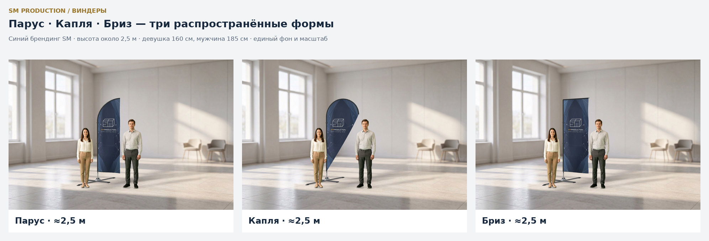

# SM Production — три формы виндеров в синем брендинге

Три отдельные каталожные визуализации: **«Парус», «Капля» и прямоугольный «Бриз»**. Синий геометрический принт, исходный бело-золотистый логотип SM Production и слоган — те же, что у [синих RollUp](../rollup-sizes-blue/README.md).

Формы выбраны по реальным каталогам. Houston Print прямо выделяет эту тройку как популярную; каталог «Заказ флагов» и отдельные карточки NordWerk подтверждают различия силуэтов. **Это распространённые формы, а не подтверждённый рейтинг продаж или заявка на наличие SM.** [10](https://houstonprint.ru/msk/stendy/flagshtok-vinder/) [2](https://zakaz-flagov.ru/flagi-vindery/)

Для сравнения все три показаны **высотой около 2,5 м**, с одинаковым типовым основанием-крестовиной. Сохранены фон комнаты, камера и пара людей: **девушка 160 см, мужчина 185 см**. Каждый файл — **1264 × 848 px**. Изделия не приближаются и не обрезаются по отдельности.

## Посмотреть и скачать

- [Сравнение трёх форм](sm-production-winder-types-comparison.jpg)
- [Ровно три JPEG одним архивом](sm-production-winder-blue-jpg.zip)
- [Все форматы — PNG, JPEG, WebP](sm-production-winder-blue-catalog.zip)
- [Что изучено в интернете и как выбраны модели](SOURCES.md)



## Отдельные изображения

| Форма | Чем отличается | JPEG | WebP | PNG без потерь |
| --- | --- | --- | --- | --- |
| Парус | Изогнутый верх, почти прямой свободный край и низ | [Открыть](sm-production-winder-parus-blue-people.jpg) | [Открыть](sm-production-winder-parus-blue-people.webp) | [Открыть](sm-production-winder-parus-blue-people.png) |
| Капля | Округлая верхняя дуга и диагональное сужение к нижнему креплению | [Открыть](sm-production-winder-kaplya-blue-people.jpg) | [Открыть](sm-production-winder-kaplya-blue-people.webp) | [Открыть](sm-production-winder-kaplya-blue-people.png) |
| Бриз | Прямоугольное полотно на вертикальной мачте с горизонтальным плечом | [Открыть](sm-production-winder-briz-blue-people.jpg) | [Открыть](sm-production-winder-briz-blue-people.webp) | [Открыть](sm-production-winder-briz-blue-people.png) |

Карточки — без стрелок, размерных линий и подписей поверх картинки. Названия форм и примерная высота есть на сравнительном листе и в манифесте.

## Конструкция и оформление

- Полотна различаются не только подписью: отдельно построены криволинейная верхушка «Паруса», полукруглая дуга и заострённый низ «Капли», прямое верхнее плечо «Бриза».
- Нижняя часть флагштока, стыковочные детали, швейный карман, нижнее крепление и крестовина показаны отдельно от ткани. Нет кассеты RollUp, замкнутой рамы «Джокер» или массивного короба.
- Использован сохранённый логотип SM, без перерисовки или растягивания. Ширина логотипа — 44 см для всех трёх форм; размещение проверяется так, чтобы форма ткани не обрезала монограмму, надпись или слоган.
- Небольшие складки, шов по краю и мягкая светотень обозначают ткань. Сильный ветер и развевающееся полотнище в спокойном интерьере не имитируются.
- Крестовина — типовой интерьерный вариант для единства сравнения. **Это не подтверждение устойчивости на улице:** основание, балласт, покрытие площадки и допустимый ветер нужно согласовать для реальной установки.

За ориентир взята размерная группа 2,5 м из открытого каталога: номинальные полотна около 220 × 63 см для «Паруса», 220 × 90 см для «Капли», 220 × 71 см для «Бриза» (в источнике высота × ширина). Визуальные контуры упрощены и не являются лекалами или чертежами конкретной модели. [2](https://zakaz-flagov.ru/flagi-vindery/)

## Проверки и использование

- Камера и точка отсчёта на полу общие с ранее подготовленными сериями.
- Фон комнаты берётся из сохранённого исходника без генерации и перерисовки.
- Все **45 248 непрозрачных пикселей людей** совпадают с утверждённым слоем; лица, одежда, рост, позы и положение не меняются.
- В PNG проверяются общая неизменная область комнаты, геометрия каждого силуэта, отсутствие обрезанных мачт и опор, а также целостность девяти экспортов.
- JPEG-архив содержит ровно 3 картинки; полный архив — 9 картинок, сравнение, манифест и пояснения. Проверяется CRC и соответствие содержимого файлам.
- На сайте сохранять весь кадр и одинаковые пропорции **1264 / 848**, рекомендуется `object-fit: contain`. Не увеличивать каждую форму отдельно до границ карточки.

Это **рекламные визуализации типовых моделей**, не фотографии собственного парка SM и не производственная документация. Реальные размеры, материал, сторона печати, комплектность, цена и наличие не утверждаются этими изображениями. Чужие товарные фотографии не копировались в итоговые изображения, водяные знаки не удалялись.

Сайт, PDF-инструкция и ранее подготовленные каталожные серии не изменены.

## Повторная сборка

```bash
python -m pip install -r visualizations/catalog/winder-types-blue/requirements.txt
python visualizations/catalog/winder-types-blue/scripts/render_winder_catalog.py
python visualizations/catalog/winder-types-blue/scripts/render_winder_catalog.py --check
```

Скрипт повторно использует проекцию, базовые материалы и экспорт из соседней серии RollUp. `manifest.json` хранит источники исследования, контуры, рост людей, модельные допущения и контрольные суммы исходных файлов. `assets/common-background-check-mask.png` задаёт общую неизменную область помещения.
