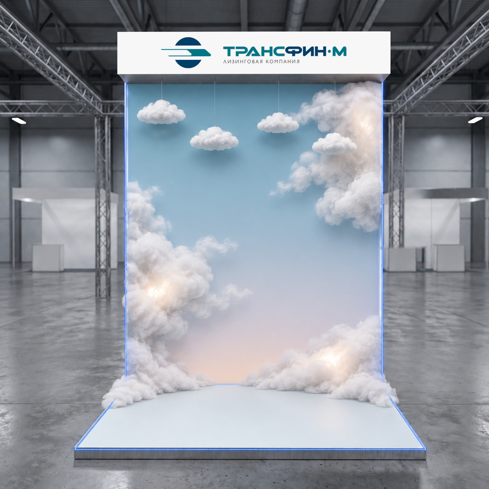
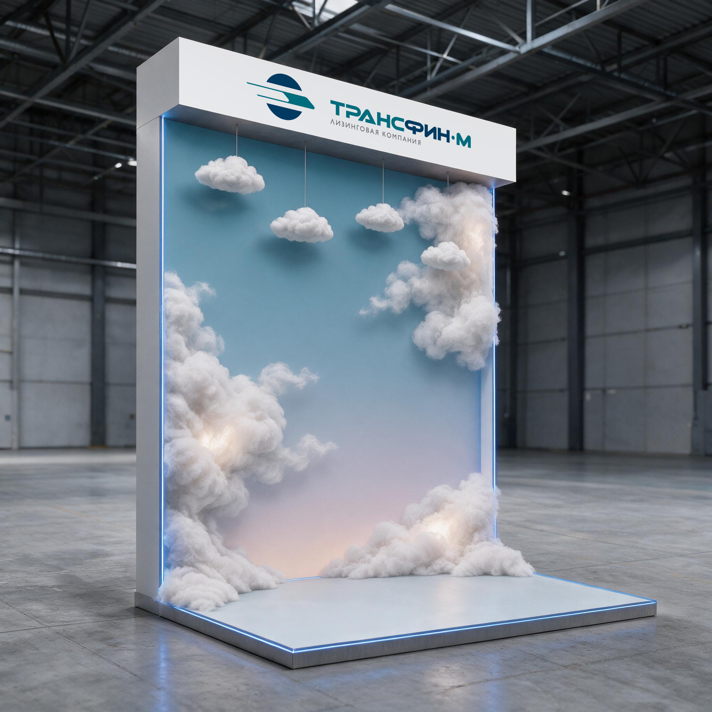
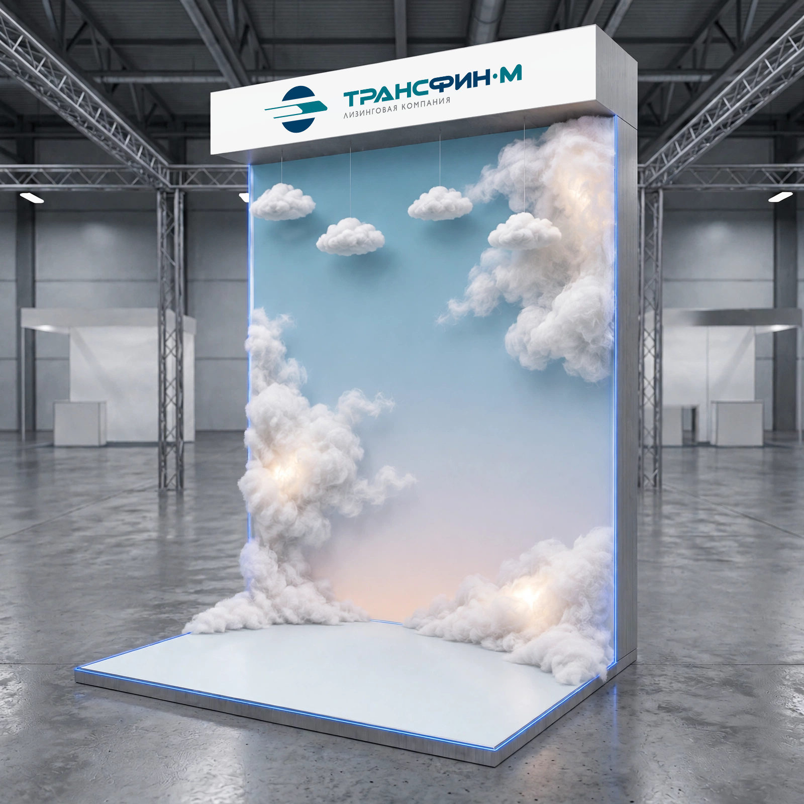
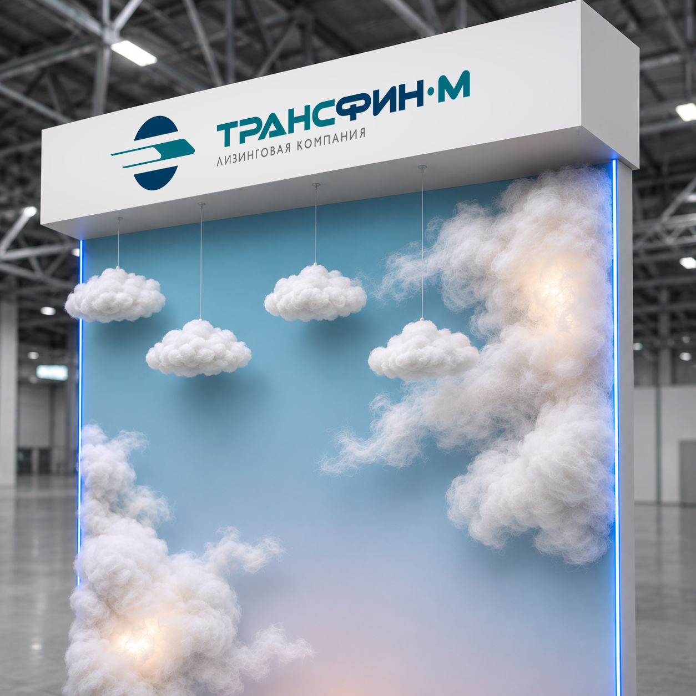
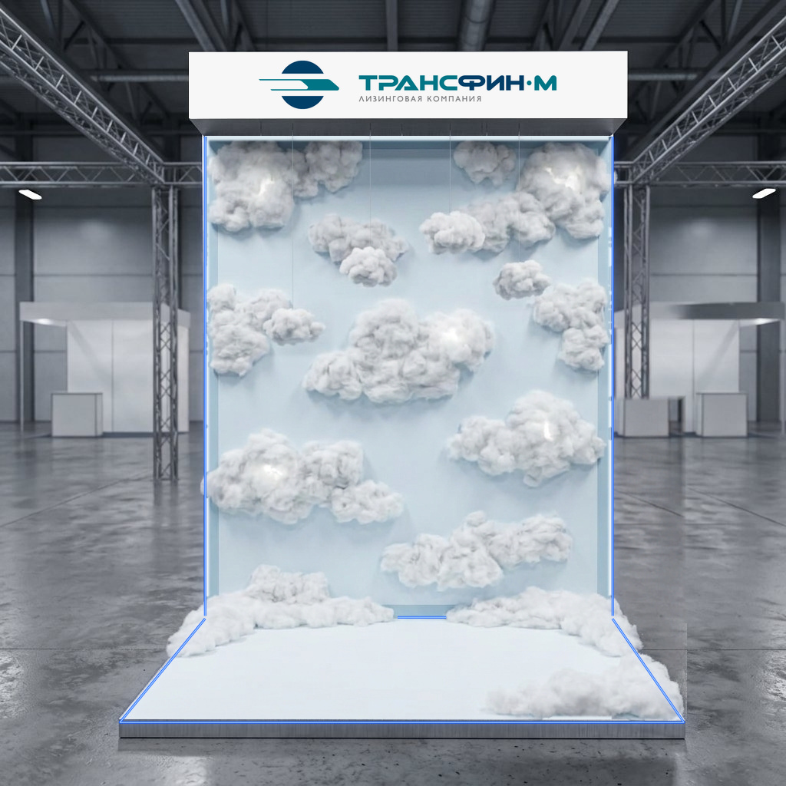
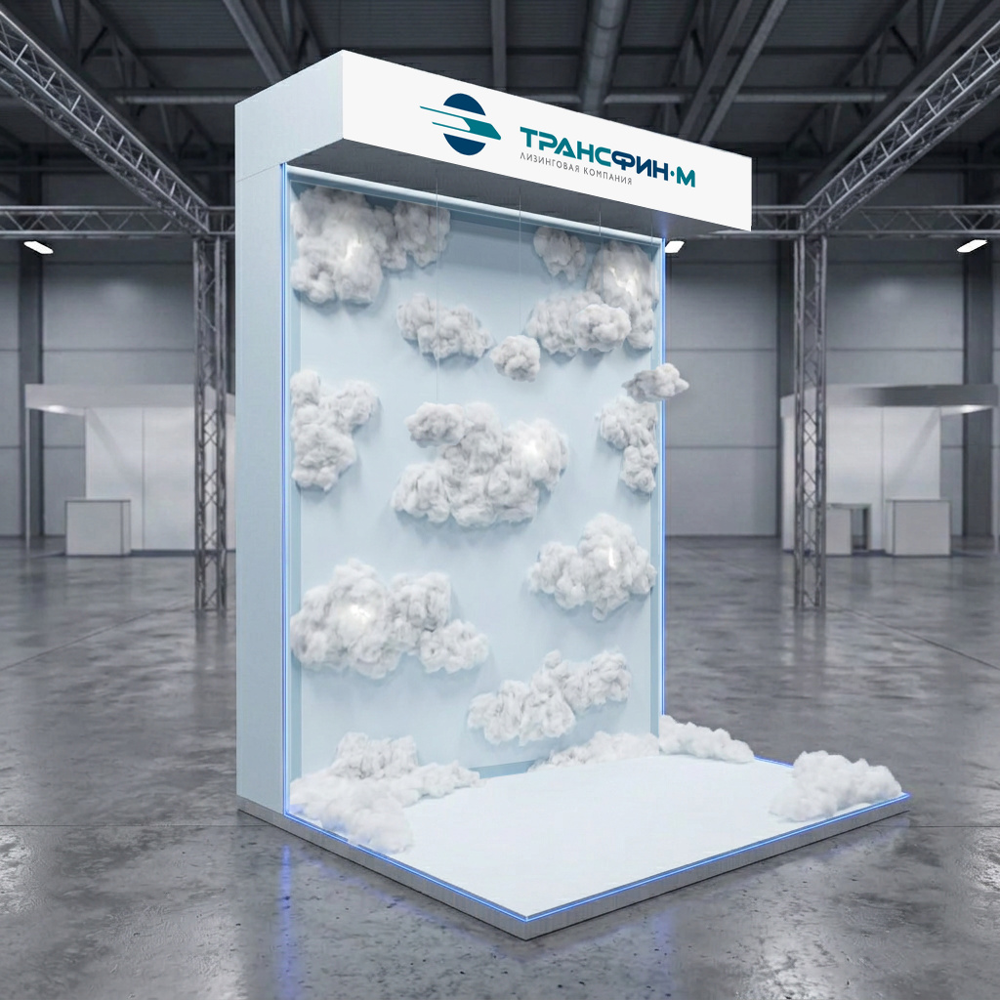
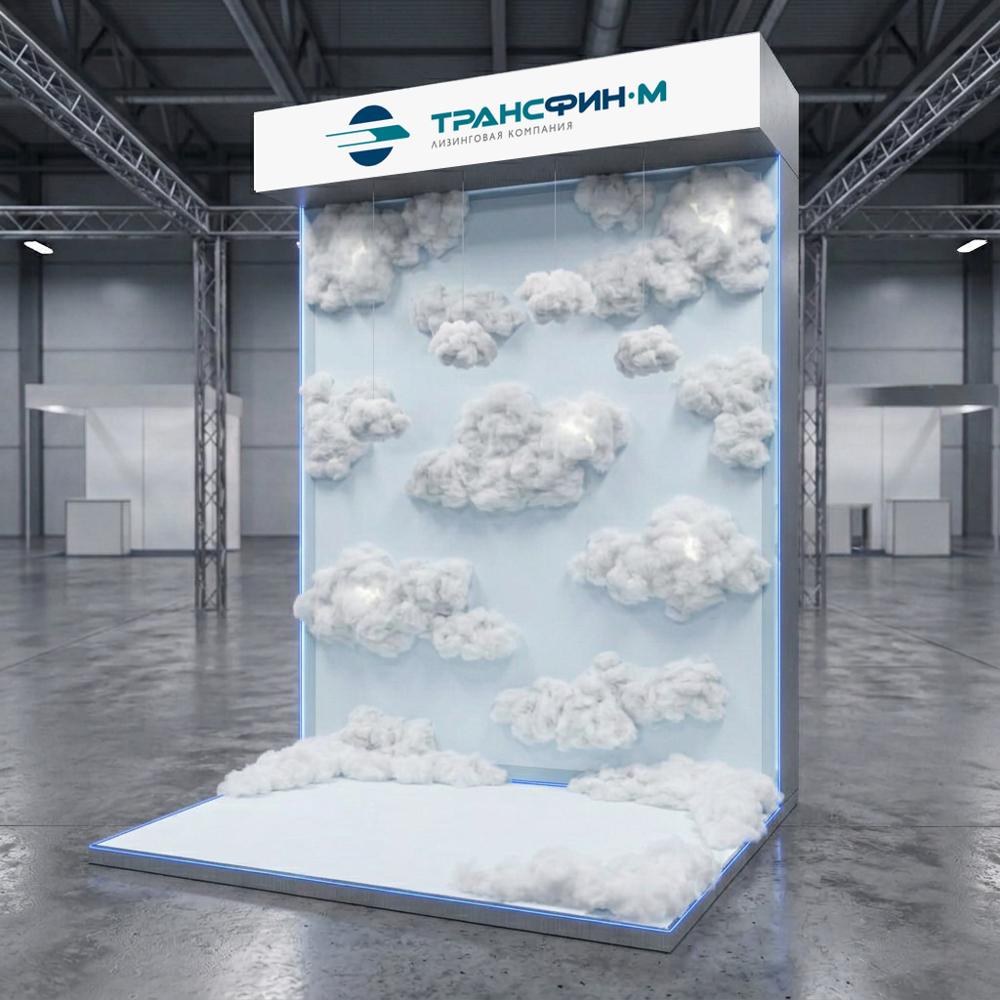

# «Диля в облаках» — проект Дили

## Новый альтернативный вариант v5: «Небесный горизонт»

Другое оформление **на той же существующей основе**: прямоугольный верхний короб с выступом, плоский задник и низкий подиум сохранены. Это отдельная концепция, а не замена файлов предыдущего варианта.

- Вместо множества небольших накладных облаков — более крупные асимметричные ватные/синтепуховые группы у левого края, в верхней правой части и у основания. Объёмный декор остаётся на нижнем, среднем и верхнем уровнях.
- Фон — печатная плёнка с плавным переходом от небесно-голубого к жемчужному и светлому персиковому горизонту, без переделки композита.
- Центр композиции и передняя часть подиума свободнее для человека и съёмки.
- Под выступом исходного короба сохранены четыре небольших облака на тонких подвесах.
- Тонкий синий контур идёт по бокам задника и периметру подиума; в отдельных облачных группах показан мягкий белый свет.
- Чёрная стойка не возвращается. На верхнем коробе использован исходный логотип «ТРАНСФИН·М» с подписью «ЛИЗИНГОВАЯ КОМПАНИЯ».

### Файлы варианта v5 — четыре ракурса

К исходному фронтальному визуалу добавлены общий вид слева, общий вид справа и близкий боковой план. Это тот же вариант «Небесный горизонт»: сохранены основа стенда, асимметричные облачные группы, градиент, четыре подвеса и расположение подсветки. На всех вывесках использован предоставленный логотип клиента.

Разрешения указаны для итоговых файлов; искусственное увеличение не применялось.

| Ракурс | Размер, пиксели | JPEG | PNG | WebP |
| --- | --- | --- | --- | --- |
| Фронтальный | 1254 × 1254 | [Открыть](dilya-v-oblakah-v5-sky-horizon.jpg) | [Открыть](dilya-v-oblakah-v5-sky-horizon.png) | [Открыть](dilya-v-oblakah-v5-sky-horizon.webp) |
| Слева | 2048 × 2048 | [Открыть](dilya-v-oblakah-v5-sky-horizon-left.jpg) | [Открыть](dilya-v-oblakah-v5-sky-horizon-left.png) | [Открыть](dilya-v-oblakah-v5-sky-horizon-left.webp) |
| Справа | 1600 × 1600 | [Открыть](dilya-v-oblakah-v5-sky-horizon-right.jpg) | [Открыть](dilya-v-oblakah-v5-sky-horizon-right.png) | [Открыть](dilya-v-oblakah-v5-sky-horizon-right.webp) |
| Крупный боковой план: облака и подвесы | 1254 × 1254 | [Открыть](dilya-v-oblakah-v5-sky-horizon-detail.jpg) | [Открыть](dilya-v-oblakah-v5-sky-horizon-detail.png) | [Открыть](dilya-v-oblakah-v5-sky-horizon-detail.webp) |

### Фронтальный вид v5

### Общий вид слева v5

### Общий вид справа v5

### Крупный боковой план v5

## Вариант v4: подвесные облака, неоновый контур и три ракурса

Оформление существующего стенда: сохранены прямоугольный верхний короб с выступом, плоский задник и низкий подиум. Новый павильон, арка или другая несущая конструкция не предлагаются.

### Что добавлено

- **Четыре небольших ватных облака** на тонких подвесах под выступающей нижней плоскостью существующего верхнего короба. Подвесы показаны на немного разной высоте, логотип не перекрыт.
- **Синий неоновый контур** вдоль периметра подиума и двух вертикальных боковых краёв задника — по расположению подсветки на реальном фото.
- Подсветка в самих настенных облаках остаётся слабой и нейтрально-белой. Общая экспозиция светлая, без тёмной синей заливки зала.
- Подготовлены фронтальный вид и два дополнительных боковых ракурса.

### Основное оформление

- Чёрная отдельно стоящая стойка удалена, графика рег.облако и круговая инфографика убраны.
- Композит оклеивается светлой бело-голубой печатной плёнкой.
- Ватные/синтепуховые облака расположены по всей высоте задника и у основания; центральное место для человека оставлено свободным.
- На исходном верхнем коробе — предоставленный логотип «ТРАНСФИН·М» с подписью «ЛИЗИНГОВАЯ КОМПАНИЯ». На вывесках использован исходный логотип клиента.

## Файлы варианта v4

Все три изображения: **1024 × 1024 пикселя**, без искусственного увеличения.

| Ракурс | JPEG | PNG | WebP |
| --- | --- | --- | --- |
| Фронтальный | [Открыть](dilya-v-oblakah-v4-front.jpg) | [Открыть](dilya-v-oblakah-v4-front.png) | [Открыть](dilya-v-oblakah-v4-front.webp) |
| Слева | [Открыть](dilya-v-oblakah-v4-left.jpg) | [Открыть](dilya-v-oblakah-v4-left.png) | [Открыть](dilya-v-oblakah-v4-left.webp) |
| Справа | [Открыть](dilya-v-oblakah-v4-right.jpg) | [Открыть](dilya-v-oblakah-v4-right.png) | [Открыть](dilya-v-oblakah-v4-right.webp) |

### Фронтальный вид

### Ракурс слева

### Ракурс справа

## Исходная конструкция и схема расположения подсветки

- [Исходный фронтальный ракурс](references/existing-stand-front.jpg)
- [Исходный боковой ракурс](references/existing-stand-angle.jpg)
- [Реальное фото — расположение неонового контура](references/neon-routing-real-photo.jpg). Использовано как пример конструкции и трассы подсветки, а не как образец экспозиции; исходная чёрная стойка в новом проекте не возвращается.
- [Логотип клиента](assets/transfin-m-logo.png)

## Предыдущая версия без подвесов и контура

- [JPEG v2](dilya-v-oblakah-v2.jpg)
- [PNG v2](dilya-v-oblakah-v2.png)
- [WebP v2](dilya-v-oblakah-v2.webp)

Эскизы показывают оформление, а не монтажную документацию. Для реализации необходимо согласовать фактические размеры и высоту подвесов, крепления к существующему коробу, пожаробезопасный декоративный материал и монтаж подсветки.
