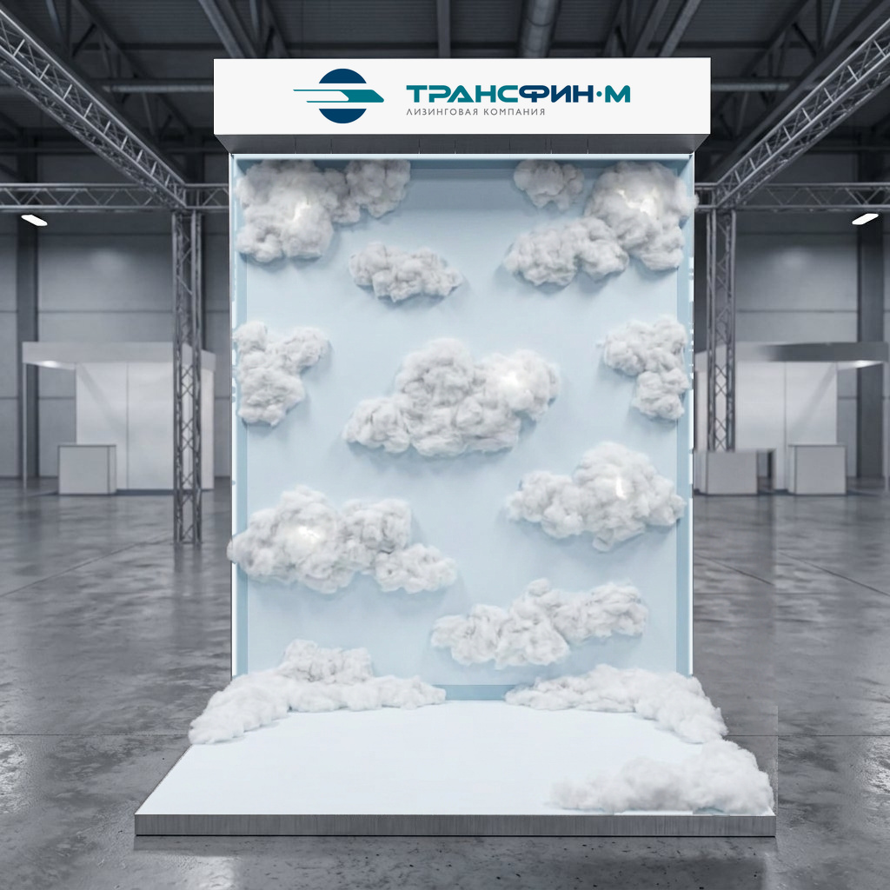
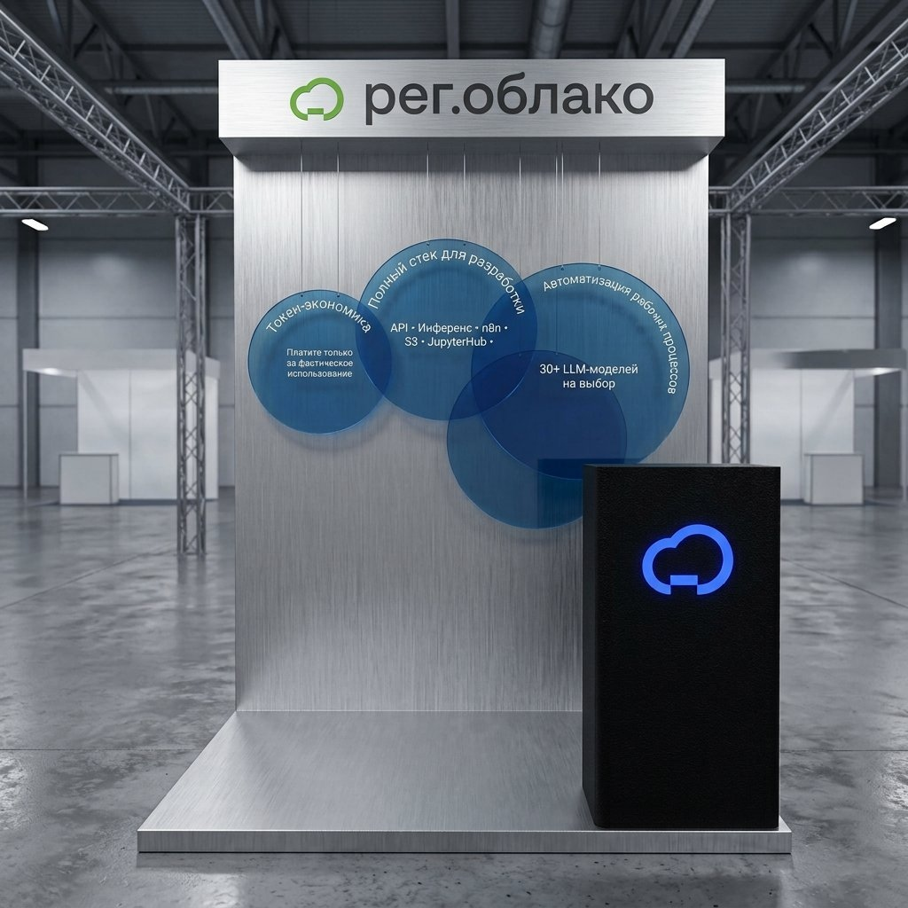

# «Диля в облаках» — проект Дили

## Вариант 2: декорирование существующей конструкции

Доработка выполнена на основе исходного фронтального изображения стенда, без предложения нового павильона, арки или другой несущей конструкции.

Сохранены исходный ракурс и визуальные пропорции:

- прямоугольного верхнего короба;
- плоского вертикального задника;
- низкого подиума и его переднего металлического торца.

## Оформление

- Чёрная отдельно стоящая стойка удалена.
- Графика рег.облако и круговая инфографика убраны.
- Существующий композит предполагается оклеить светлой бело-голубой печатной плёнкой.
- На заднике размещены накладные ватные/синтепуховые облака на нижнем, среднем и верхнем уровнях, а не только над головой.
- Невысокие облачные элементы добавлены у основания и по сторонам площадки; центральное место для человека оставлено свободным.
- В отдельных облаках показан слабый рассеянный свет скрытых LED, без цветного неона и световых контуров.
- На исходном верхнем коробе размещён предоставленный логотип «ТРАНСФИН·М» с подписью «ЛИЗИНГОВАЯ КОМПАНИЯ». В итоговом PNG использован исходный логотип, а не сгенерированная надпись.

Эскиз показывает оформление, а не монтажную документацию. Для реализации необходимо согласовать фактические размеры, крепления, пожаробезопасный декоративный материал и монтаж подсветки.

## Доработанный визуал

- [JPEG](dilya-v-oblakah-v2.jpg)
- [PNG](dilya-v-oblakah-v2.png)
- [WebP](dilya-v-oblakah-v2.webp)

Разрешение: **1024 × 1024**, без искусственного увеличения.

## Исходная конструкция для сравнения

- [Фронтальный ракурс](references/existing-stand-front.jpg)
- [Боковой ракурс](references/existing-stand-angle.jpg)
- [Логотип клиента](assets/transfin-m-logo.png)

