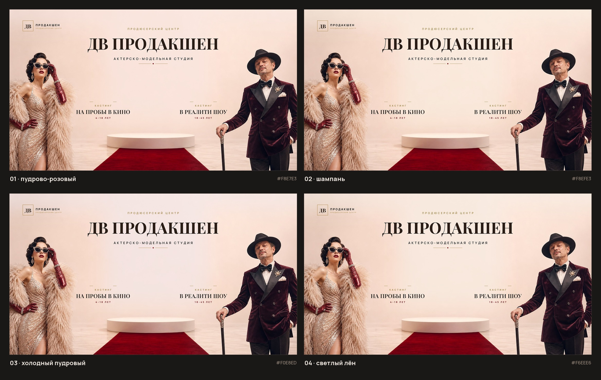

# ДВ Продакшен — актёрско-модельная студия

Новый макет афиши по правкам клиента к баннерам «Я — звезда».
Формат: горизонтальный **16:9** (2400×1350) и вертикальный **4:5** (1600×2000) — под сайт, соцсети и экраны.



---

## Что исправлено (по пунктам клиента)

| # | Правка клиента | Что сделано в макете |
|---|---|---|
| 1 | Фон более нежный | Пудрово-персиковая стена, мягкий градиент, без холодных теней. **4 варианта** на выбор — см. `variants/` и `preview-*-varianty.jpg` |
| 2 | Дорожка подиума — красная | Глубокий бордо-красный подиумный «ковёр» с отражением на полу; насыщенность поднята отдельно, чтобы при любой тонировке оставался красным |
| 3 | Люди по бокам — эпатажнее | Дива в золотом пайеточном платье, огромном перьевом боа, вишнёвых перчатках и украшенных очках-«кошке»; мужчина в бордовом велюровом смокинге, широкой шляпе, с тростью и брошью. Оба срезаны краем кадра — как в fashion-съёмке |
| 4 | «Я — звезда» → «ДВ Продакшен» | Заголовок по центру: **ДВ ПРОДАКШЕН** (крупно, антиква Playfair Display) |
| 5 | Логотип в верхний угол | Логотип-заглушка в левом верхнем углу: монограмма «ДВ» в золотой рамке + «ПРОДАКШЕН · ПРОДЮСЕРСКИЙ ЦЕНТР». **Меняется на ваш файл без правки кода** — `assets/dv-logo.png` |
| 6 | По центру — «актёрско-модельная студия» | Подзаголовок под названием: **АКТЕРСКО-МОДЕЛЬНАЯ СТУДИЯ** (вразрядку, Manrope) + тонкий орнамент |
| 7 | Слева «кастинг на пробы в кино (4–18)» | Блок слева: `КАСТИНГ` → **НА ПРОБЫ В КИНО** → `4–18 ЛЕТ` |
| 8 | Справа «кастинг в реалити шоу (18–45)» | Блок справа: `КАСТИНГ` → **В РЕАЛИТИ ШОУ** → `18–45 ЛЕТ` |
| 9 | «Поднять ДВ Продакшен» | Название вынесено на самый верх по центру, крупнее всех остальных строк; блоки кастинга опущены ниже, чтобы не конкурировать |

---

## Файлы

```
dv-production/
├── dv-production-poster-16x9.jpg      ← основной макет 16:9 (2400×1350)
├── dv-production-post-4x5.jpg         ← основной макет 4:5 (1600×2000)
├── preview-16x9-varianty.jpg          ← лист со всеми 4 вариантами фона
├── preview-4x5-varianty.jpg
├── variants/
│   ├── 16x9--01-pudrovyj-rozovyj.jpg  … 04-svetlyj-len.jpg
│   └── 4x5--01-pudrovyj-rozovyj.jpg   … 04-svetlyj-len.jpg
├── build.py                           ← сборка макетов (Pillow)
├── previews.py                        ← лист вариантов
├── fonts/                             ← Playfair Display + Manrope (OFL)
├── assets/dv-logo.png                 ← положите сюда логотип (пока нет — рисуется заглушка)
└── source/
    ├── base-horizontal-v5.jpg         ← фотореалистичная подложка 16:9
    ├── base-vertical-v2.jpg           ← подложка 4:5
    └── raw/                           ← черновые генерации подложек
```

---

## Как вносить правки самому

Все надписи набираются шрифтами, а не генератором — поэтому в русском тексте
нет опечаток и «поехавших» букв. Правится всё в `build.py`:

```bash
python -m venv .venv && ./.venv/bin/pip install pillow   # один раз
./.venv/bin/python build.py        # пересобрать все макеты и варианты
./.venv/bin/python previews.py     # пересобрать листы превью
```

- **Тексты** — словарь `TEXTS` в начале `build.py` (название, подзаголовок, возраста, «кастинг»).
- **Цвета текста** — `PALETTE` (`ink` — коньячный, `gold`, `wine`).
- **Фон** — `WALL_VARIANTS`: пары «hex + сила тонировки». Присланный референс
  достаточно вписать как новый hex (например `#F3E6E1`) и пересобрать —
  люди и красная дорожка защищены маской и не выцветают.
- **Логотип** — положить PNG с прозрачным фоном в `assets/dv-logo.png`;
  размер и позиция в углу подхватятся автоматически.
- **Подложка (люди, позы, свет)** — заменить `source/base-*.jpg` и пересобрать;
  координаты блоков заданы в дизайн-единицах холста 1672×941 (16:9) и 1122×1402 (4:5).

---

## Тексты в макете (для проверки)

- `ПРОДЮСЕРСКИЙ ЦЕНТР` — надстрочная строка над названием
- `ДВ ПРОДАКШЕН` — заголовок
- `АКТЕРСКО-МОДЕЛЬНАЯ СТУДИЯ` — подзаголовок
- `КАСТИНГ / НА ПРОБЫ В КИНО / 4–18 ЛЕТ` — левый блок
- `КАСТИНГ / В РЕАЛИТИ ШОУ / 18–45 ЛЕТ` — правый блок
- логотип: `ДВ · ПРОДАКШЕН · ПРОДЮСЕРСКИЙ ЦЕНТР`

> Если «актёрско» нужно с буквой **ё** — поменяйте `TEXTS["studio"]`
> в `build.py` на `АКТЁРСКО-МОДЕЛЬНАЯ СТУДИЯ` и пересоберите. Сейчас
> оставлено «АКТЕРСКО» по тексту правки клиента.

---

## Следующие шаги

- [ ] Прислать референс фона → подставлю точный оттенок (или скажите номер варианта 01–04)
- [ ] Прислать файл логотипа → встанет в угол вместо заглушки
- [ ] Вертикальный 9:16 для сторис/Reels (сделаю из того же макета)
- [ ] Версия под печать 5×3 м (300 dpi) — PDF/CMYK по запросу
