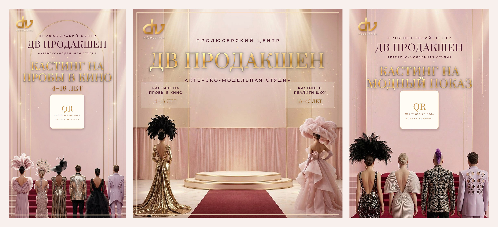

# ДВ Продакшен — серия баннеров актёрско-модельной студии

Финальная серия из трёх макетов по правкам клиента к баннерам «Я — звезда».
Дизайн собран кодом (`scripts/build_dv_banners.py`): сцена — рендер, вся типографика
набрана точными шрифтами, поэтому в надписях нет «поехавших» букв и опечаток.



---

## Файлы

| Файл | Формат | Размер | Куда |
|---|---|---|---|
| `dv-production-banner-square.jpg` | 1:1 | 3072×3072 | главный баннер серии: сайт, соцсети, печать до 52×52 см (150 dpi) |
| `dv-production-casting-kino.jpg` | ~9:16 (4:7,2) | 2400×4300 | баннер «Кастинг на пробы в кино» — печать / сторис |
| `dv-production-casting-pokaz.jpg` | 2:3 | 2400×3600 | баннер «Кастинг на модный показ» — печать / сторис |
| `preview-*.jpg` | — | 1100 px | превью для просмотра и согласования |
| `preview-all-formats.jpg` | — | 2850×1300 | лист со всеми тремя макетами |
| `work/plate-square.jpg`, `work/plate-kino.jpg`, `work/plate-pokaz.jpg` | — | 800–1024 px | чистые подложки-рендеры (без текста), из них собираются макеты |

---

## Что исправлено (по пунктам клиента)

| # | Правка клиента | Что сделано |
|---|---|---|
| 1 | Фон более нежный | Вся сцена перекрашена в светлый пудрово-розовый: розовый лепесток, бледный румянец, шампань-золото в свете. Убраны бордо, коричневый и «пыльный» беж из прошлой версии |
| 2 | Цвет дорожки подиума — красный | Глубокий карминно-красный ковёр от нижнего края кадра к подиуму; отдельно поднята насыщенность, чтобы при любой тонировке дорожка оставалась красной |
| 3 | Люди по бокам — эпатажнее | Слева — золотое пайеточное платье с длинным шлейфом и огромный чёрный страусовый головной убор; справа — скульптурный розовый тюлевый кутюр, перьевая шляпа и длинные перчатки. Оба срезаны краем кадра, как в fashion-съёмке. В вертикальных макетах — ряд гостей в пайетках, перьях и широких шляпах |
| 4 | «Я звезда» → «ДВ ПРОДАКШЕН» | Заголовок по центру набран антиквой Prata с металлическим золотым градиентом, фаской и тенью |
| 5 | Логотип в верхний угол | Монограмма `dv` + подпись `PRODUCTION` в левом верхнем углу, с мягкой тенью. Монограмма вырезана из исходного макета клиента (файл `assets/brand/dv-production-monogram.png`) — при появлении векторного логотипа просто замените файл, код править не нужно |
| 6 | По центру — «актёрско-модельная студия» | Строка `АКТЁРСКО-МОДЕЛЬНАЯ СТУДИЯ` вразрядку под названием, во всех трёх макетах |
| 7 | Слева «кастинг на пробы в кино (4–18)» | Отдельный блок слева: `КАСТИНГ НА / ПРОБЫ В КИНО` + золотом `4–18 ЛЕТ` |
| 8 | Справа «кастинг в реалити шоу (18–45)» | Отдельный блок справа: `КАСТИНГ В / РЕАЛИТИ-ШОУ` + золотом `18–45 ЛЕТ` |
| 9 | «Поднять ДВ Продакшен» | Название — самая крупная строка, поднято в верхнюю треть; блоки кастинга уведены ниже и по краям, чтобы не конкурировать с названием |

Порядок строк в вертикальных макетах выстроен так, чтобы бренд читался первым:

```
ПРОДЮСЕРСКИЙ ЦЕНТР
ДВ ПРОДАКШЕН            ← крупно
АКТЁРСКО-МОДЕЛЬНАЯ СТУДИЯ
────────────────
КАСТИНГ НА ПРОБЫ В КИНО / КАСТИНГ НА МОДНЫЙ ПОКАЗ   ← золотом
4–18 ЛЕТ
QR-код на форму записи
```

---

## QR-код

В макетах стоит аккуратная плашка-заглушка «место для QR-кода».
Как только будет ссылка на форму записи:

```bash
/tmp/venv/bin/python scripts/make_qr.py "https://ссылка-на-форму" kino
/tmp/venv/bin/python scripts/make_qr.py "https://ссылка-на-другую-форму" pokaz
/tmp/venv/bin/python scripts/build_dv_banners.py
```

`kino` → `visualizations/dv-production/qr-kino.png`, `pokaz` → `qr-pokaz.png`.
Скрипт сборки сам подхватит эти файлы и вставит их вместо заглушки —
с белой подложкой, скруглением и золотой обводкой.

---

## Пересборка

```bash
python3 -m venv .venv
./.venv/bin/pip install -r visualizations/dv-production/requirements.txt
./.venv/bin/python scripts/build_dv_banners.py
```

Все тексты, размеры и позиции — в `scripts/build_dv_banners.py`:

- `GOLD_STOPS` / `DEEP_GOLD_STOPS` — металлический градиент золота;
- `build_square()` — главный баннер 1:1;
- `build_kino()` — «Кастинг на пробы в кино»;
- `build_pokaz()` — «Кастинг на модный показ»;
- `SIZE`, `MARGIN`, `panel_w` — сетка и отступы.

Разрешение печати задаётся там же (`SIZE` / `W`, `H`). Подложки — 1024 px,
поэтому выше 3072 px по короткой стороне детализации не добавится;
для баннера 3×4 м печатайте с 3072 px (≈100 dpi с расстояния 2–3 м — норма).

---

## Шрифты

`assets/fonts/` — Prata (антиква для заголовков) и Montserrat Variable
(подписи, разрядка), лицензия OFL, файлы лицензий рядом.

---

## Архив

`archive/v1-16x9-4x5/` — первая версия макета (16:9 + 4:5, четыре варианта фона,
сборка на Pillow с логотипом-заглушкой). Оставлена для истории и сравнения.
