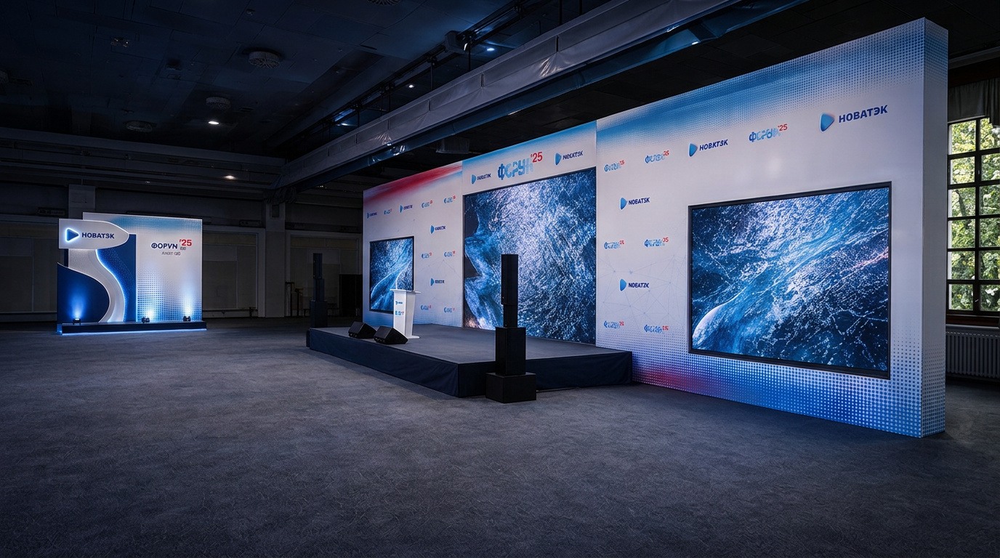

# Визуализация для главной страницы — форумная сцена и фотозона

Фотореалистичная визуализация на основе фотографий одной площадки: вечерняя форумная сцена без столов, с отдельной имиджевой фотозоной.

## Актуальная доработка — v2

- Сохранён понравившийся дизайн бело-синей скульптурной фотозоны.
- Фотозона отодвинута левее и в глубину зала, дальше от сцены. Между ними оставлен широкий свободный проход.
- Камера смещена правее и ближе к правому экрану, ближе к ракурсу исходного фото.
- Сохранены вечернее освещение, три LED-экрана с синим контентом и свободный передний план без столов.
- Без наложенного водяного знака SM Production.

### Файлы v2

- [PNG — основной файл](forum-hero-photozone-v2.png)
- [JPEG — версия для универсального использования](forum-hero-photozone-v2.jpg)
- [WebP — облегчённая версия для сайта](forum-hero-photozone-v2.webp)

Разрешение v2: **1376 × 768 пикселей**, без искусственного увеличения.

## Предыдущий вариант — v1

Исходная версия с более фронтальным ракурсом и фотозоной ближе к сцене сохранена для сравнения.

- [PNG v1](forum-hero-photozone.png)
- [JPEG v1](forum-hero-photozone.jpg)
- [WebP v1](forum-hero-photozone.webp)

Разрешение v1: **1360 × 768 пикселей**.

