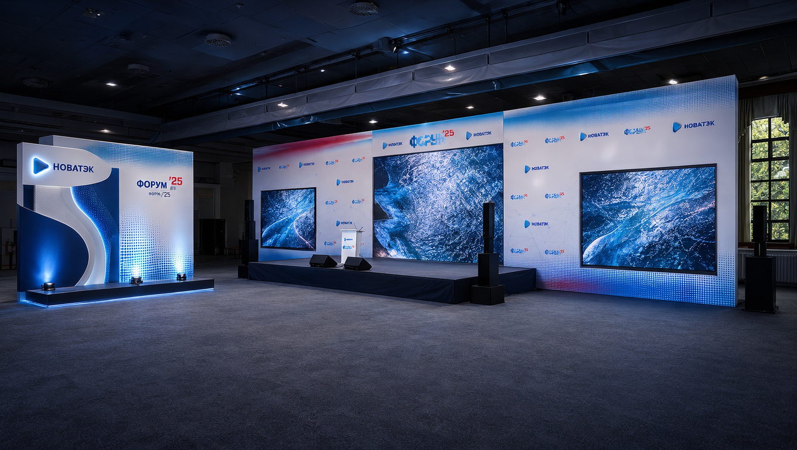

# Визуализация для главной страницы — форумная сцена и фотозона

Выбранный вариант изображения для главной страницы сайта, подготовленный на основе двух фотографий одной площадки.

## Изменения

- Убраны банкетные столы, передний план оставлен свободным.
- Слева от сцены добавлена отдельная имиджевая фотозона в стилистике форума.
- Ракурс — промежуточный между широким почти фронтальным снимком и исходным боковым фото.
- Сохранены вечерняя атмосфера, архитектура площадки и три встроенных LED-экрана.
- На экранах — синий форумный визуальный контент вместо тестовых таблиц.
- Без наложенного водяного знака SM Production.

## Файлы

- [PNG — основной файл](forum-hero-photozone.png)
- [JPEG — версия для универсального использования](forum-hero-photozone.jpg)
- [WebP — облегчённая версия для сайта](forum-hero-photozone.webp)

Все версии имеют разрешение **1360 × 768 пикселей**, без искусственного увеличения.

