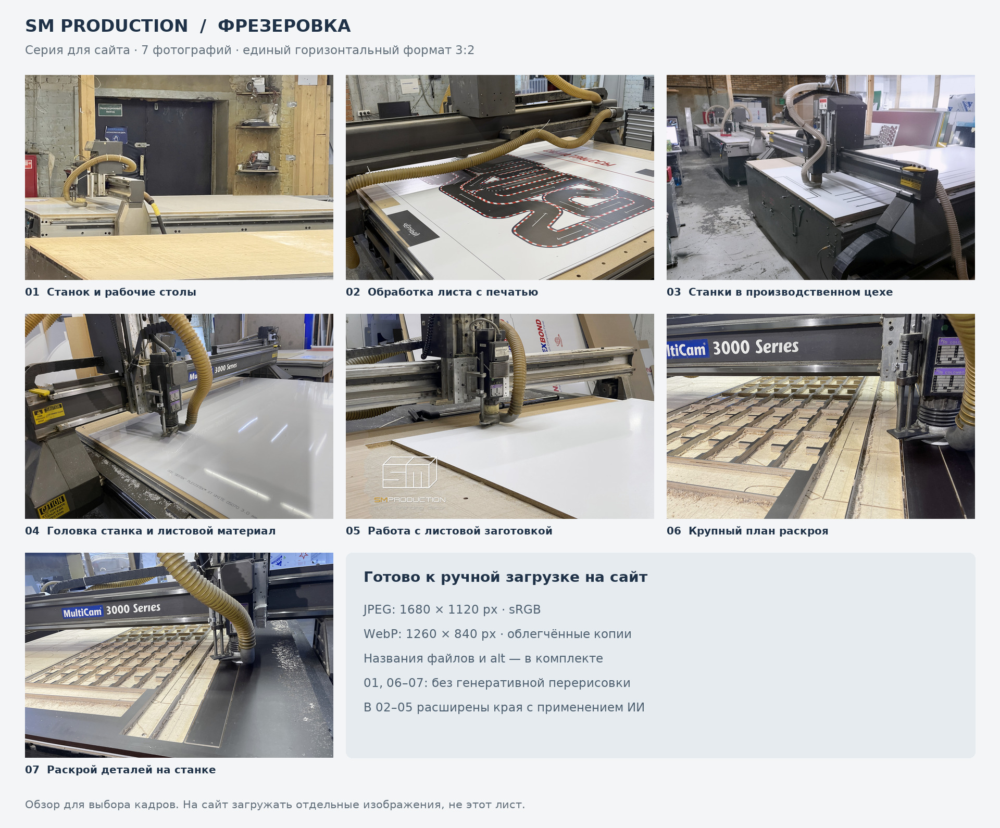

# SM Production — фотографии фрезеровки для сайта

Серия из **семи фотографий производства, предоставленных пользователем**. Единая обработка: нейтральные светлые участки, открытые тени, естественное дерево и тёмный металл; одинаковый горизонтальный формат **3:2**. Это первая версия для отбора владельцем перед публикацией.

## Посмотреть и скачать

- [Обзор семи кадров](sm-production-milling-overview.jpg) — для выбора, не вместо отдельных фото.
- [Скачать 7 JPEG](sm-production-milling-jpeg.zip) — **1680 × 1120 px**, sRGB.
- [Скачать 7 облегчённых WebP](sm-production-milling-webp.zip) — **1260 × 840 px**, sRGB.
- [Файл → alt](image-alt.csv) — семь описаний изображений; UTF-8 с BOM, разделитель `;`.
- [Манифест](manifest.json) — соответствие исходникам, обработка, размеры, точные веса и SHA-256.



## Отдельные кадры

| № | Исходник | Сюжет | JPEG | WebP |
| --- | --- | --- | --- | --- |
| 01 | `IMG_2993.jpg` | Станок и рабочие столы | [Скачать](sm-production-milling-01-workshop.jpg) | [Скачать](sm-production-milling-01-workshop.webp) |
| 02 | `IMG_7308.jpg` | Обработка листа с печатью | [Скачать](sm-production-milling-02-printed-panel.jpg) | [Скачать](sm-production-milling-02-printed-panel.webp) |
| 03 | `DSC_1249.JPG` | Станки в производственном цехе | [Скачать](sm-production-milling-03-machines.jpg) | [Скачать](sm-production-milling-03-machines.webp) |
| 04 | `IMG_0481.jpg` | Головка станка и листовой материал | [Скачать](sm-production-milling-04-sheet-milling.jpg) | [Скачать](sm-production-milling-04-sheet-milling.webp) |
| 05 | `IMG_1667 копия.jpg` | Работа с листовой заготовкой | [Скачать](sm-production-milling-05-white-sheet.jpg) | [Скачать](sm-production-milling-05-white-sheet.webp) |
| 06 | `IMG_1706.jpg` | Крупный план раскроя | [Скачать](sm-production-milling-06-nested-parts-detail.jpg) | [Скачать](sm-production-milling-06-nested-parts-detail.webp) |
| 07 | `IMG_1707.jpg` | Раскрой деталей на станке | [Скачать](sm-production-milling-07-nested-parts-wide.jpg) | [Скачать](sm-production-milling-07-nested-parts-wide.webp) |

Для обложки раздела — **04**, для общего вида цеха — **03**, для демонстрации раскроя — **06 и 07**. Подписи лучше размещать отдельным текстом сайта, а не поверх оборудования.

## Обработка и границы дорисовки

- Свет и цвет выровнены во всей серии: смягчены сдвиги смешанного освещения, поднята читаемость теней, умеренно скорректированы контраст, насыщенность и резкость.
- **02–05:** кадры расширены с применением ИИ; поверх совмещённых расширенных фонов восстановлены ключевые области исходных фотографий. Периферийные поля содержат дорисовку. В 02 исправлена широкая размытая граница у нижнего левого края листа.
- **01:** генеративный широкий вариант отклонён, поскольку менял оборудование. Финал основан на оригинале: горизонтальное кадрирование, свет/цвет, локальное клонирование фактуры стены вместо пакетов на заднем плане. Человек, коробка с обрезками и отвлекающие предметы у краёв исключены кадром. **Расширения этого кадра нет** — приоритет отдан реальному станку, а не выдуманной широкой сцене.
- **05:** сохранены исходные головка, шланг, форма листа с уступом/вырезом слева и фактура верстака. **Исходная подпись SM Production внизу оставлена:** её удаление давало заметную потерю фактуры и затрагивало кромку заготовки. Новые логотипы в остальные кадры не добавлялись. Инструмент на заднем поле сохранён, это не мусор.
- **06–07:** сохранены исходные ракурс, станок и раскрой без генеративной замены. Выполнены коррекция света/цвета, кадрирование по полной ширине с сокращением нижнего переднего плана и осторожная точечная уборка на пустом поле. Эти кадры **не расширены**.
- Отдельный бытовой мусор и отвлекающие детали убраны, но нормальный износ оборудования и технологическая стружка около вырезанных деталей сохранены. Цех не превращён в стерильную студию.
- Готовые фото — sRGB; EXIF/GPS не перенесены. Пользовательские оригиналы не перезаписывались.

**Это отретушированная серия для оформления сайта, а не техническая документация.** По дорисованным краям 02–05 нельзя определять размеры, комплектацию или количество оборудования. Неудачные промежуточные генерации с изменёнными станками, раскроем и профилем листа в комплект не включены.

## Загрузка на сайт

1. Для лёгкой галереи использовать WebP; если редактор не принимает этот формат — JPEG.
2. Загружать отдельные изображения, не скриншоты обзорного листа. Не вытягивать их по ширине/высоте; сохранять пропорцию 3:2.
3. Alt брать из `image-alt.csv` для соответствующего имени файла. Он описывает изображение, не обещает цену, производительность или наличие.
4. Для фото ниже первого экрана использовать отложенную загрузку, если редактор её поддерживает. Проверить мобильную обрезку головки станка и листа.
5. Перед публикацией владелец выбирает нужные кадры и подтверждает допустимость размещения видимых рабочих материалов/принтов.

На действующем сайте ничего не опубликовано. Единый PDF, тарифы и прежние каталожные серии не изменены.

## Проверка и повторная упаковка

JPEG здесь — отобранные мастер-экспорты ретуши. Скрипт **не** восстанавливает ретушь из оригиналов и не вызывает генератор: он создаёт из JPEG WebP, обзор, alt-реестр и два архива с семью фото в каждом.

```bash
python -m pip install -r visualizations/production/milling/requirements.txt
python visualizations/production/milling/scripts/package_photos.py
python visualizations/production/milling/scripts/package_photos.py --check
```

Для обзорного листа нужны DejaVu Sans / DejaVu Sans Bold в `/usr/share/fonts/truetype/dejavu/`. Проверяются 14 фотографий, размеры/пропорция, sRGB, отсутствие EXIF, лимит веса, семь alt, SHA-256 и точное соответствие архивов отдельным файлам. В ZIP только готовые изображения; исходные загрузки и промежуточные варианты не включены.
