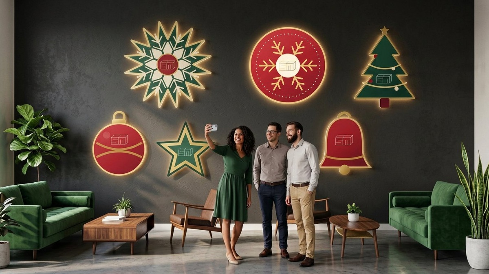
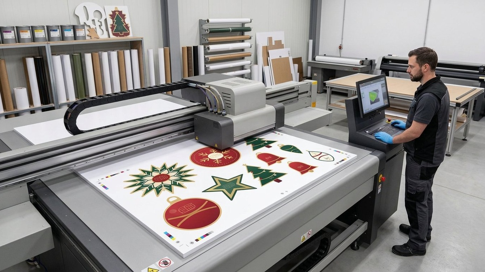
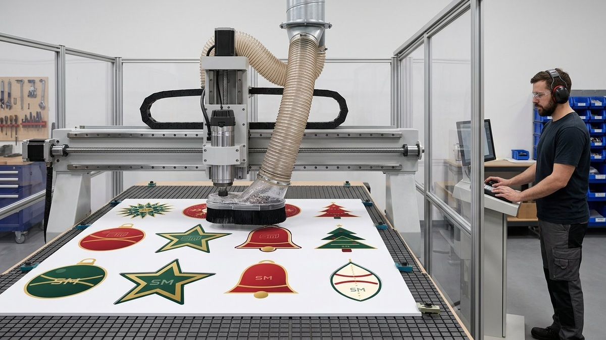
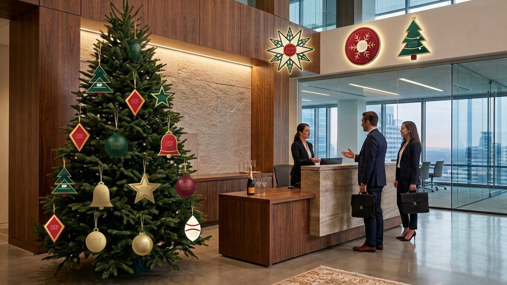
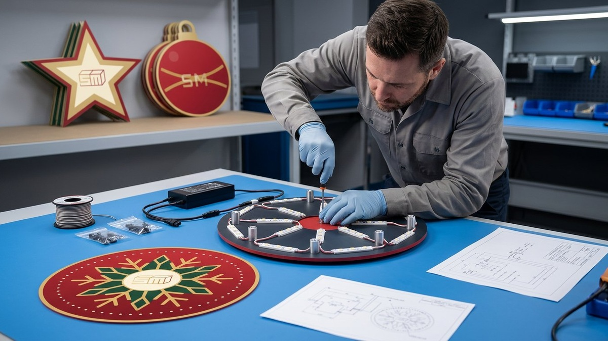
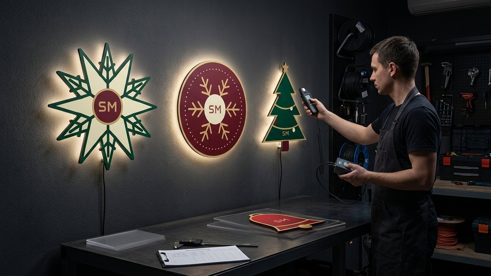
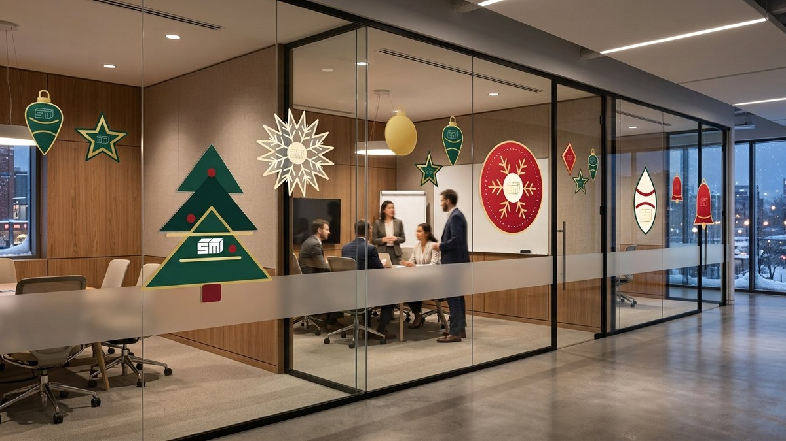

# Брендированные элементы оформления для офисов и коммерческих интерьеров

Чтобы обновить офис к празднику, запуску продукта или корпоративному событию, не обязательно переделывать весь интерьер. Иногда достаточно нескольких точных элементов: фирменных фигур на стене, графики на стекле, оформления ресепшена или небольшой фотозоны.

Такие решения можно изготовить двумя основными способами:

- **из листового ПВХ** — когда нужны жёсткая форма, объём, фигурный контур или подсветка;
- **из легкосъёмной плёнки** — когда поверхность должна остаться свободной после завершения кампании.

Материалы решают разные задачи и хорошо работают вместе. Например, крупные элементы с контражуром можно установить на стене, а стеклянные перегородки дополнить плёночным узором в той же графике.

## Что можно оформить

Брендированные элементы подходят не только для новогоднего декора. На одной технологии можно построить сезонную, рекламную или навигационную систему для разных коммерческих пространств.

В офисах и общественных интерьерах чаще всего оформляют:

- ресепшен и входную зону;
- переговорные и стеклянные перегородки;
- коридоры и зоны совместной работы;
- брендированные стены и корпоративные фотозоны;
- витрины, двери и окна;
- зоны ожидания и клиентские офисы;
- шоурумы, магазины и автосалоны;
- гостиницы, клиники, рестораны и торговые центры;
- временные точки навигации и сезонные POS-материалы.

Форма может повторять логотип, фирменный паттерн, продукт, пиктограмму или тематический символ. Главное — проектировать элемент не отдельно от помещения, а с учётом масштаба стены, направления движения людей, освещения и расстояния просмотра.

## Жёсткие элементы из ПВХ

Листовой вспененный ПВХ — лёгкий материал для интерьерных панелей, фигур, табличек и декоративных композиций. На него можно нанести полноцветное изображение, вырезать сложный контур, выполнить внутренние отверстия и подготовить крепление.

Для небольших накладок может подойти тонкий лист. Для крупных фигур, напольных элементов и вывесок выбирают более жёсткий материал. Толщина определяется после проверки размера, формы, количества узких участков и способа монтажа: одно значение не подходит для всех конструкций.

### Как изготавливают элементы из ПВХ

Производство начинается не с печати, а с технической подготовки макета. Дизайнер отделяет графику от линии реза, задаёт вылеты и проверяет, не окажутся ли лучи снежинки, тонкие буквы или декоративные перемычки слишком хрупкими.

Далее процесс выглядит так:

1. элементы раскладывают на листе с учётом рабочего поля оборудования;
2. изображение печатают непосредственно на ПВХ на планшетном УФ-принтере или сначала печатают на плёнке и накатывают её на лист;
3. напечатанный лист фиксируют на вакуумном столе фрезерного станка с ЧПУ;
4. фреза проходит по отдельному векторному контуру каждого элемента;
5. детали очищают, проверяют кромку и комплектуют креплением;
6. при необходимости устанавливают дистанционные держатели и заднюю подсветку;
7. готовый комплект собирают на тестовом участке и только после этого отправляют на объект.

### Когда ПВХ особенно уместен

ПВХ стоит выбирать, если элемент должен:

- сохранять точную фигурную форму;
- выступать над поверхностью и создавать глубину;
- устанавливаться на дистанционные держатели;
- использоваться повторно;
- подвешиваться на тросах или лентах;
- работать как самостоятельная табличка или панель;
- получить контражурную подсветку;
- перекрывать неровность или технический участок стены.

Жёсткие элементы можно снять, упаковать и установить повторно. Но возможность повторного использования зависит от формы, крепежа и условий хранения: тонкие выступающие части нуждаются в защитной упаковке.

## Вывески с контражуром

Контражур — это мягкий световой ореол за фигурой. Светодиодные модули находятся на обратной стороне, а сама вывеска устанавливается с небольшим отступом от стены. Свет направлен назад, поэтому лицевая графика остаётся печатной и не превращается в яркий световой короб.

Такое решение хорошо подходит для ресепшена, переговорной, корпоративной гостиной или фотозоны. Контражур добавляет глубину, подчёркивает фигурный край и делает элемент заметным в вечернем освещении.

Чтобы эффект выглядел аккуратно, нужно заранее проверить:

- материал и цвет стены;
- расстояние от вывески до поверхности;
- положение светодиодных модулей;
- равномерность ореола;
- доступ к блоку питания и обслуживанию;
- возможность скрыть проводку;
- отражения в стекле и соседних глянцевых поверхностях.

Контражур лучше работает на сплошной непрозрачной стене. На стеклянной перегородке свет будет виден с обратной стороны, а проводка и крепления станут частью интерьера. Для стекла обычно рациональнее использовать плёнку, а световую вывеску разместить на соседней стене.

## Оформление легкосъёмной плёнкой

Легкосъёмная плёнка подходит для временной графики на стекле и других совместимых гладких поверхностях. Её используют для сезонных узоров, навигации, витринных кампаний, оформления переговорных и брендирования входной группы.

Плёнка может быть:

- белой непрозрачной с полноцветной печатью;
- прозрачной с печатной графикой;
- матовой или имитирующей травлёное стекло;
- цветной, вырезанной по контуру на плоттере;
- комбинированной — например, матовый фон и цветные акцентные элементы.

### «Легкосъёмная» не означает «подходит для любой стены»

Легкосъёмность — это свойство конкретного клеевого слоя и выбранного срока эксплуатации, а не универсальная гарантия отсутствия следов.

Перед монтажом важно проверить основание. Риск повреждения или остаточного клея выше на:

- свежей краске, которая ещё не набрала прочность;
- рыхлых, меловых и загрязнённых поверхностях;
- бумажных обоях;
- фактурной штукатурке;
- старой краске со слабой адгезией к стене;
- поверхностях после агрессивной бытовой химии или полиролей.

Поэтому для окрашенной стены рекомендуется тестовый образец на незаметном участке. На стекле результат обычно предсказуемее, но и здесь нужно учитывать старые покрытия, тонировку, обогрев, швы и состояние поверхности.

### Как проходит монтаж плёнки

1. Поверхность осматривают и очищают подходящим составом.
2. Графику раскладывают по стеклянным секциям, дверям и стыкам.
3. Элементы наносят по разметке, контролируя расстояния и направление рисунка.
4. Крупные полотна стыкуют с учётом обзора с обеих сторон.
5. После монтажа проверяют края, углы и зоны рядом с ручками.
6. При демонтаже плёнку снимают в рекомендованном температурном режиме и очищают поверхность, если это требуется.

Если оформление рассчитано на короткую кампанию, способ демонтажа нужно обсуждать до печати, а не после завершения проекта.

## ПВХ или легкосъёмная плёнка: сравнение

| Критерий | Элементы из ПВХ | Легкосъёмная плёнка |
|---|---|---|
| Внешний вид | Жёсткая фигурная деталь, видимая глубина | Графика визуально остаётся частью поверхности |
| Лучшие основания | Стены, панели, подготовленные крепления | Стекло и совместимые гладкие поверхности |
| Фигурный контур | Фрезеровка по векторной линии | Плоттерная резка или контурная резка печатной плёнки |
| Контражур | Возможен на дистанционных держателях | Обычно не применяется |
| Повторное использование | Возможно при сохранности детали и крепежа | Обычно проектируется под один цикл размещения |
| Скорость замены | Нужно снять крепления или подвесы | Графику можно удалить и заменить новой |
| Хранение | Нужны коробки, прокладки и место | Не требуется после завершения кампании |
| Поверхность после демонтажа | Зависит от типа крепления | Зависит от плёнки, срока, основания и условий снятия |
| Визуальный акцент | Подходит для главного элемента композиции | Подходит для фоновой графики и больших площадей |

## Почему часто лучше комбинировать материалы

Выбор не обязательно сводится к одному материалу. В коммерческом интерьере ПВХ и плёнка решают разные уровни задачи.

Практичная комбинация может выглядеть так:

- над ресепшеном — крупный фигурный элемент из ПВХ с контражуром;
- на стеклянных переговорных — матовая плёнка и сезонные акценты;
- в коридоре — небольшая серия жёстких настенных фигур;
- в клиентской зоне — временная навигация из плёнки;
- в фотозоне — несколько крупных элементов из ПВХ;
- на входной двери — часы работы или анонс кампании из съёмной графики.

Так интерьер сохраняет цельность, но не становится перегруженным. Жёсткие элементы создают акценты, а плёнка объединяет большие поверхности.

## Как проект начинается на практике

Для расчёта недостаточно только логотипа. Нужны фотографии пространства и примерные размеры зон. Если планируется монтаж, желательно провести замер и проверить основания на объекте.

Работа обычно проходит в восемь этапов:

1. **Бриф.** Определяем цель, срок размещения, аудиторию и зоны оформления.
2. **Обследование.** Проверяем размеры, материалы стен и стекла, электропитание и доступ для монтажа.
3. **Концепция.** Показываем элементы в интерьере и согласовываем масштаб.
4. **Технология.** Выбираем ПВХ, плёнку, печать, резку, подсветку и крепления.
5. **Макеты.** Готовим печатную графику и отдельные векторные контуры.
6. **Производство.** Печатаем, фрезеруем или режем плёнку, собираем световые элементы.
7. **Контроль.** Проверяем цвет, размеры, комплектность и световой ореол.
8. **Монтаж и демонтаж.** Устанавливаем оформление и заранее фиксируем порядок его последующего удаления.

Подробно о возможностях материала можно прочитать на странице [печати на ПВХ](/uslugi/pechat-na-pvh), а комплексный подход описан в разделе [брендирования офисов и интерьеров](/uslugi/oformlenie-intererov).

## Что чаще всего ухудшает результат

### Слишком много элементов

Даже красивый паттерн быстро превращается в визуальный шум, если одинаково заполнить стены, стекло и ресепшен. Лучше выбрать один главный акцент и поддержать его более спокойной графикой.

### Неправильный масштаб

Мелкая снежинка, которая хорошо выглядит на экране, может потеряться на стене высотой три метра. И наоборот, крупный элемент способен перекрыть навигацию или обзор через стекло. Масштаб нужно проверять на визуализации и по реальным размерам.

### Контражур без проверки стены

Неровная, глянцевая или слишком тёмная поверхность меняет характер ореола. До производства полезно проверить образец подсветки на материале, близком к реальной стене.

### Плёнка без теста

Фраза «она же съёмная» не заменяет проверку основания. Ошибка становится заметна только при демонтаже, когда исправлять уже поздно.

### Отсутствие плана демонтажа

Временное оформление должно не только быстро устанавливаться, но и предсказуемо сниматься. В смете важно учитывать упаковку многоразовых элементов, удаление плёнки и восстановление поверхности при необходимости.

## Где это особенно хорошо работает

**Офисы.** Сезонное оформление ресепшена, переговорных и корпоративных пространств без постоянной перестройки.

**Шоурумы и автосалоны.** Тематические кампании, презентации моделей, оформление зоны выдачи и клиентского маршрута. Для комплексных задач можно использовать подходы из раздела [оформления автосалонов](/uslugi/oformlenie-avtosalonov).

**Магазины и торговые центры.** Витринная графика, подвесные элементы, POS и фотозоны.

**Гостиницы и рестораны.** Сезонные композиции в лобби, входной группе и зоне ожидания.

**Клиники и клиентские офисы.** Спокойная брендированная графика, навигация и временные информационные кампании.

## Что прислать для предварительного расчёта

Чтобы быстрее получить реалистичную концепцию и смету, подготовьте:

- фотографии каждой зоны прямо и под углом;
- примерные ширину и высоту стен или стеклянных секций;
- брендбук, логотипы и фирменные цвета;
- желаемый срок размещения;
- информацию о возможности сверления и электроподключения;
- требование к повторному использованию;
- дату, к которой оформление должно быть установлено;
- контакт технического специалиста площадки, если он есть.

Если точных размеров пока нет, можно начать с фотографий и общего плана. После выбора направления проводится замер.

## Частые вопросы

### Можно ли снять легкосъёмную плёнку совсем без следов?

На совместимой чистой поверхности и в пределах рекомендованного срока — чаще всего да. Но результат зависит от клеевого слоя, температуры, длительности размещения и состояния основания. Поэтому мы рекомендуем тест, особенно на окрашенных стенах и покрытиях неизвестного состава.

### Можно ли наносить плёнку на окрашенную стену?

Иногда можно, но только после проверки краски и тестового нанесения. Свежая, рыхлая, меловая или слабо держащаяся краска может сняться вместе с плёнкой. Для сложных стен безопаснее рассмотреть жёсткую панель на согласованном креплении.

### Какую толщину ПВХ выбрать?

Она зависит от размера, контура и способа монтажа. Для небольшой накладки и крупной вывески требуются разные решения. Толщину определяют после проверки геометрии, креплений и необходимости подсветки.

### Можно ли сделать элементы с контражуром?

Да. Для этого проектируют отступ от стены, размещение светодиодных модулей, питание и скрытую проводку. До производства важно проверить поверхность стены и собрать световой образец.

### Можно ли использовать элементы из ПВХ повторно?

Да, если конструкция, крепление и упаковка рассчитаны на повторный монтаж. При хранении детали разделяют мягкими прокладками и защищают тонкие выступающие части.

### Что дешевле — ПВХ или плёнка?

Сравнивать только стоимость квадратного метра некорректно. Плёнка обычно выгоднее для больших гладких поверхностей и краткосрочных кампаний. ПВХ дороже как изделие, но даёт объём, фигурный край, подсветку и возможность повторного использования.

### Можно ли разработать дизайн с нуля?

Да. Достаточно прислать фотографии помещения, брендбук или логотип, задачу и желаемый срок. Мы подготовим концепцию, производственные макеты и предложим подходящие материалы.

## Итог

ПВХ и легкосъёмная плёнка не конкурируют, а дополняют друг друга. ПВХ создаёт выразительные фигурные акценты, глубину и возможность подсветки. Плёнка помогает быстро оформить стекло и большие площади, а затем заменить графику без капитальной переделки интерьера.

Лучший результат получается, когда дизайн, производство и монтаж проектируются одновременно. Тогда форма соответствует возможностям фрезеровки, плёнка подходит к основанию, крепления не мешают интерьеру, а контражур выглядит мягко и равномерно.

**Хотите оформить офис, шоурум или клиентское пространство?** Пришлите фотографии зон, примерные размеры и брендбук. SM Production подготовит варианты из ПВХ, легкосъёмной плёнки или их комбинации и рассчитает производство с монтажом.

Посмотреть другие решения можно в [портфолио](/portfolio), а обсудить задачу — в разделе [контактов](/kontakty).
