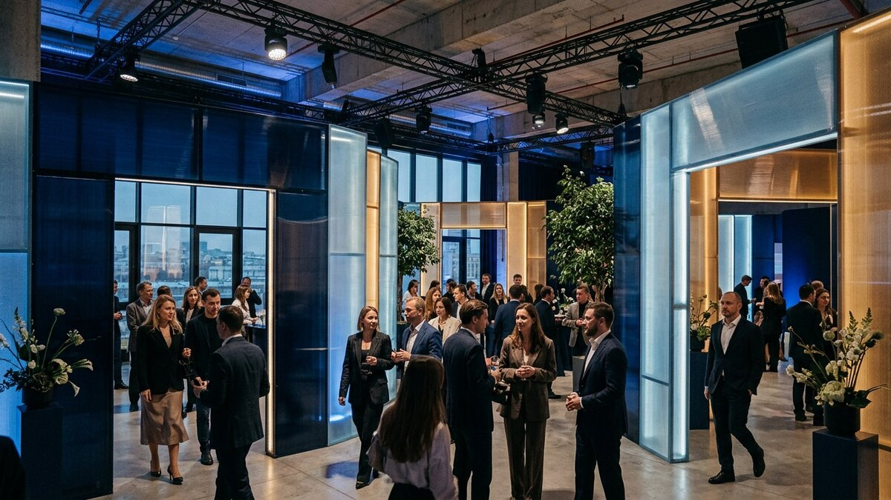
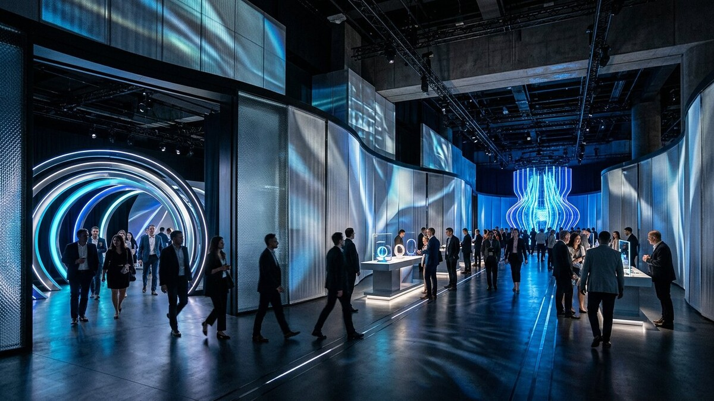
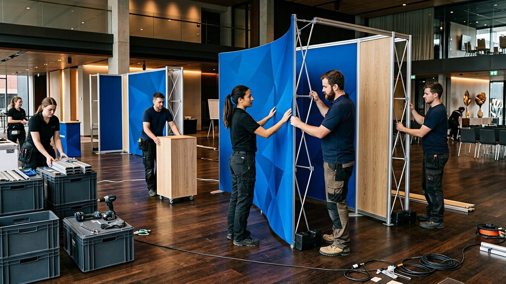
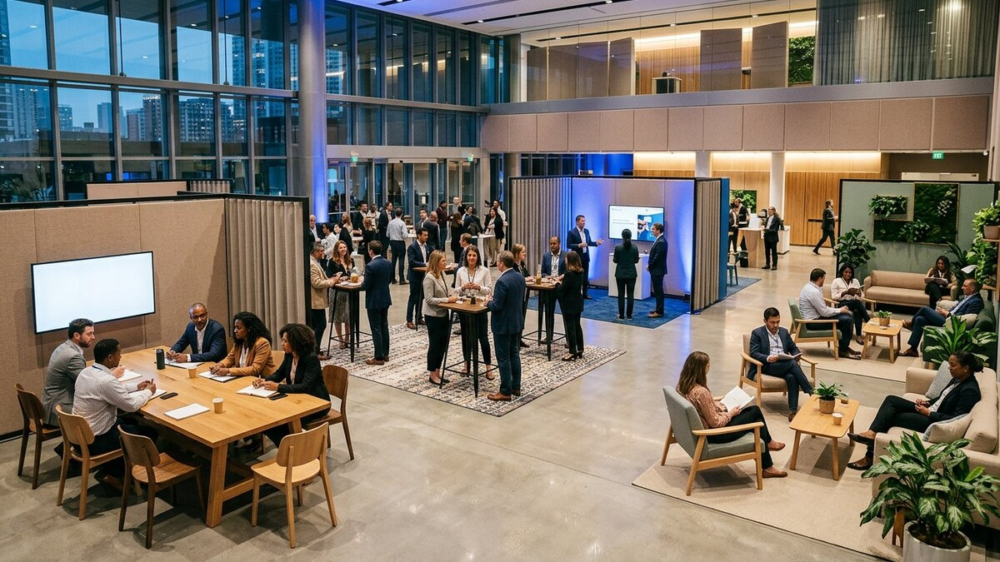
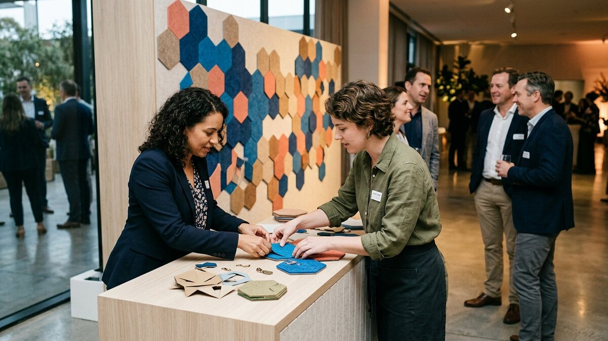
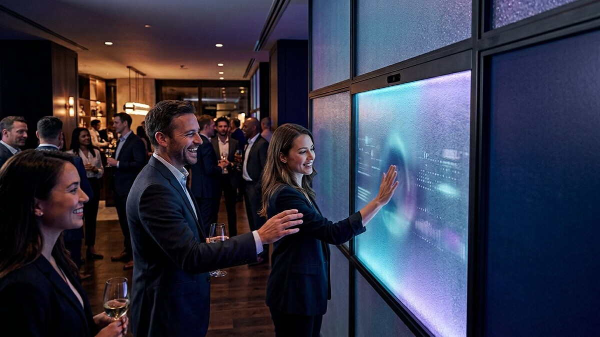
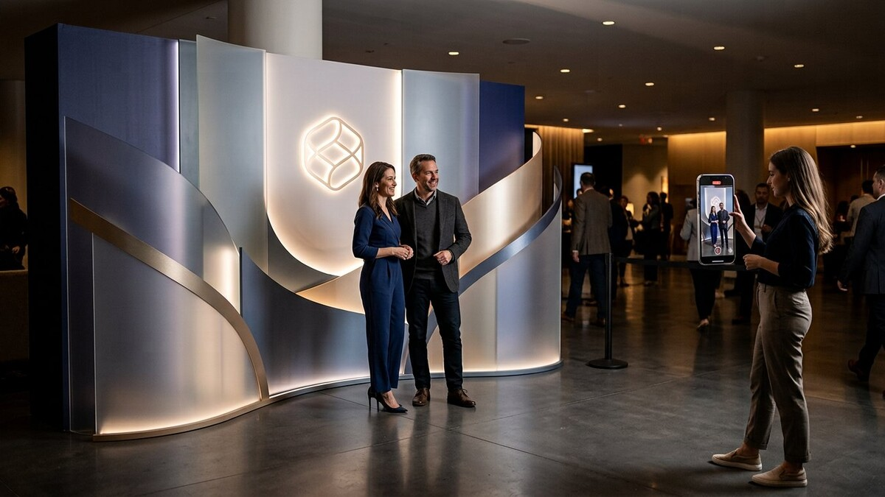

# Что будет популярно в оформлении мероприятий в 2027 году

В 2027 году оформление события всё меньше похоже на набор отдельных декораций. Сцена, входная группа, навигация, бренд-зона, свет и контент для социальных сетей проектируются как единый маршрут гостя. Важен уже не самый большой экран или самый сложный арт-объект, а то, насколько последовательно пространство раскрывает идею бренда.

Это прогноз, подготовленный осенью 2026 года на основе направлений, которые уже заметны в индустрии: иммерсивной сценографии, персонализации, модульного производства, разумной интеграции технологий и более внимательного отношения к комфорту гостей. Не каждый тренд нужен каждому событию. Сильная концепция обычно выбирает два-три направления и доводит их до результата, а не пытается использовать всё сразу.

## Коротко: главные тренды оформления мероприятий 2027 года

1. **Сценография с единым сюжетом** вместо набора несвязанных фотозон и баннеров.
2. **Иммерсивность через свет, материал и движение**, а не технология ради технологии.
3. **Тактильная цифровая эстетика**: прозрачные слои, металл, текстиль, фактура и мягкие градиенты света.
4. **Модульные конструкции и повторное использование** с заменяемой графикой.
5. **Микрозоны и человеческий масштаб** даже внутри большого зала.
6. **Персонализация и соавторство**, когда гость влияет на результат.
7. **Незаметные интерактивные технологии**, встроенные в физическую среду.
8. **Пространства, заранее подготовленные для фото и вертикального видео**.
9. **Бренд-коды вместо “стены из логотипов”**: узнаваемость через форму, цвет, материал и свет.

| Тренд | Как выглядит | Для чего подходит |
|---|---|---|
| Единый сюжет | Связанный маршрут от входа до финальной зоны | Запуски продуктов, форумы, премии |
| Иммерсивный свет | Световые переходы, проекции, меняющиеся сценарии | Сцена, презентация, вечерняя программа |
| Тактильная цифровая эстетика | Полупрозрачные панели, сетка, металл, ткань, многослойность | Технологические и премиальные бренды |
| Модульность | Переставляемые каркасы и сменная графика | Серии мероприятий, гастрольные проекты |
| Микрозоны | Лаунж, переговорная, демо- и тихая зоны | Конференции, выставки, деловые события |
| Персонализация | Индивидуальный маршрут, подарок или общий арт-объект | Клиентские и HR-мероприятия |
| “Невидимые” технологии | Реакция света или контента на действие гостя | Интерактивные бренд-зоны |
| Контент-зоны | Свет, глубина и ракурсы под 9:16 и 16:9 | PR-события, фестивали, корпоративные мероприятия |
| Бренд-коды | Фирменная пластика без повторения логотипа на каждой поверхности | Премиальные и имиджевые проекты |

## 1. Сценография вместо набора декораций

Главный сдвиг 2027 года — переход от отдельных объектов к цельному пространственному сценарию. Входная арка, стойка регистрации, сцена, навигация, выставочные модули и фотозона должны говорить на одном визуальном языке и последовательно вести человека по событию.

У такого подхода есть простая логика:

- **вход** обещает тему и задаёт ожидание;
- **маршрут** помогает открыть ключевые смыслы;
- **центральная зона** становится эмоциональной кульминацией;
- **финальная точка** закрепляет впечатление и даёт повод сохранить или опубликовать контент.

Это не означает, что каждый проект должен превращаться в театральную постановку. Для деловой конференции сюжет может быть очень спокойным: одна модульная геометрия повторяется в портале, сцене и навигации, а свет меняет её восприятие в течение дня. Для запуска продукта маршрут может строиться как последовательность “проблема — открытие — демонстрация — участие”.

**Практический вывод:** начинать концепцию стоит не с вопроса “какую сделать фотозону?”, а с вопроса “что должен почувствовать и сделать гость на каждом участке маршрута?”. После этого становится понятно, какие конструкции действительно нужны.

## 2. Иммерсивность без технологического шума

Иммерсивность останется популярной, но станет более точной. Огромный экран, проекция или датчик сами по себе не создают вовлечение. В 2027 году сильнее будут работать решения, в которых свет, звук, материал и действие гостя поддерживают одну идею.

Иммерсивная среда может быть построена без сложной виртуальной реальности:

- световой портал меняет температуру цвета при переходе из зоны в зону;
- полупрозрачные слои создают глубину при движении человека;
- направленный звук работает только в определённой точке;
- проекция дополняет физический рельеф, а не маскирует пустую стену;
- подсветка меняется вместе со сценарием выступления;
- механический или ручной элемент позволяет гостю открыть часть истории.

Важная тенденция — **технология не должна выглядеть отдельным аттракционом**, если это не является задачей бренда. Кабели, датчики, технические люки и обслуживание закладываются на стадии чертежа. Тогда интерактив воспринимается как естественное свойство пространства.

## 3. Тактильная цифровая эстетика

После нескольких лет экранной и “стерильно цифровой” эстетики в оформление возвращается материальность. Технологический образ создаётся не только дисплеями, но и тем, как свет проходит через поверхность, как выглядит кромка детали и как сочетаются матовые, прозрачные и отражающие слои.

В 2027 году будут особенно актуальны:

- полупрозрачный поликарбонат и акрил;
- перфорированный металл и сетчатые поверхности;
- акустический текстиль и мягкие панели;
- шлифованный металл без избыточного зеркального блеска;
- натуральное или окрашенное дерево как тёплый контраст;
- рельефная печать и объёмные накладные элементы;
- матовые плёнки, градиентная прозрачность и эффект слоёв;
- один насыщенный фирменный цвет на спокойной нейтральной базе.

Популярная палитра не обязательно будет одинаковой у всех. Важнее сочетание **холодного управляемого света и тёплой физической фактуры**. Оно хорошо выглядит вживую и помогает избежать ощущения, что мероприятие происходит внутри компьютерной визуализации.

При выборе материалов нельзя ориентироваться только на референс. Нужно проверить пожарные требования площадки, вес, способ крепления, устойчивость, возможность безопасного демонтажа и то, как материал выглядит в реальном свете камеры.

## 4. Модульность и повторное использование

Модульная конструкция — не просто “экологичный” тренд. Это способ управлять бюджетом, сроками и логистикой серии событий. Один набор каркасов может работать как входная группа, задник сцены, переговорная зона или выставочный стенд, если система спроектирована заранее.

Хорошая модульность предполагает:

- стандартную сетку размеров;
- заменяемую печатную графику;
- несколько вариантов сборки из одного комплекта;
- крепления, рассчитанные на повторные циклы;
- понятную маркировку деталей;
- ремонтопригодность;
- транспортную упаковку;
- перечень элементов после демонтажа и место хранения.

Повторное использование нельзя подтверждать одной фразой в презентации. Если после мероприятия конструкцию негде хранить, тонкие детали ломаются при перевозке, а новый зал требует полностью другой геометрии, обещание не работает.

Поэтому в 2027 году более убедительным будет **план следующего применения**: какие элементы сохраняются, что перепечатывается, как конструкция адаптируется под меньшую площадку и кто отвечает за комплектность.

Для серии событий можно заранее спроектировать базовый набор: порталы, стеновые модули, подиумы, стойки и световые элементы. От события к событию меняются конфигурация, цвет света и графика, но не весь конструктив.

## 5. Микрозоны и человеческий масштаб

Большой зал не обязан ощущаться как одно огромное помещение. В 2027 году события будут чаще делить пространство на небольшие эмоциональные и функциональные зоны:

- компактные места для переговоров;
- тихие зоны без громкой музыки и яркого света;
- мягкие лаунжи для короткого отдыха;
- столы для совместной работы;
- демонстрационные острова;
- мини-сцены и зоны вопросов;
- места для записи интервью или подкаста.

Зонирование можно выполнить без тяжёлых стен. Для этого используют свет, ковровые покрытия, мебель, акустические панели, подвесные элементы, невысокие перегородки и изменение плотности декора.

Этот тренд связан не только с эстетикой. Продуманная среда учитывает разные сценарии поведения: кто-то готов сразу включиться в общение, кому-то нужен короткий перерыв, а кому-то — спокойное место для разговора.

### Что проверить при проектировании микрозон

- достаточно ли широки основные проходы;
- не перекрывает ли очередь соседнюю активность;
- есть ли места для людей с разной мобильностью;
- можно ли пользоваться интерактивом сидя и стоя;
- не мешают ли свет и звук соседним зонам;
- понятен ли маршрут без постоянных подсказок персонала;
- остаётся ли доступ к аварийным выходам и техническим узлам.

Доступность и комфорт — не самостоятельная стилистика, а базовое качество проекта.

## 6. Персонализация и соавторство гостей

Именная табличка на входе — самый простой уровень персонализации. Более интересный подход позволяет гостю выбрать маршрут, создать предмет, повлиять на световую сцену или добавить часть в общую инсталляцию.

Популярными будут механики, где результат остаётся после события:

- персонализированный принт или небольшой сувенир;
- общая композиция, которую гости собирают из модулей;
- портрет или абстрактная графика, созданные на основе ответа человека;
- выбор цвета, темы или продукта, меняющий последующий контент;
- цифровой материал, который гость получает после физического действия;
- коллективная карта идей, достижений или пожеланий.

Сильная механика должна быть понятна за несколько секунд и не создавать длинную очередь. Если для участия нужно заполнить большую анкету, установить приложение и пройти регистрацию ещё раз, вовлечение превращается в барьер.

Также важно заранее определить, какие данные действительно нужны. Для красивой реакции света не всегда требуется идентифицировать человека. Чем проще и прозрачнее механика, тем естественнее участие.

## 7. Незаметные интерактивные технологии

В 2027 году интерактив будет чаще встроен в декорацию, а не поставлен рядом отдельным экраном. Датчик движения, NFC-метка, кнопка, световой контроллер или короткофокусный проектор становятся частью конструкции.

Практичные сценарии:

- световая поверхность реагирует на приближение;
- физический макет запускает связанный видеосюжет;
- касание образца материала открывает его характеристики;
- цвет зоны меняется по результатам общего голосования;
- электронная метка выдаёт персональную подборку после мероприятия;
- навигация адаптируется к этапу программы.

У технологии должен быть **резервный сценарий**. Если интернет нестабилен или датчик временно недоступен, зона не должна превращаться в пустой чёрный экран. Физическая композиция обязана сохранять смысл без интерактива, а технические специалисты — иметь доступ к оборудованию без демонтажа всей стены.

Для подобных задач полезно объединять производство декораций и разработку механики на раннем этапе. Раздел [интерактивных стендов](/uslugi/interaktivnye-stendy) показывает, какие задачи можно решать на стыке физической конструкции и цифрового контента.

## 8. Оформление, подготовленное для фото и вертикального видео

“Фотогеничность” больше не означает одну стену с логотипами. Событие снимают в разных форматах: общий план 16:9, вертикальные клипы 9:16, интервью, короткие реакции, прямые включения и репортажные фотографии.

В 2027 году контентные ракурсы будут закладывать в планировку до производства:

- вертикальная композиция должна работать без случайно обрезанных элементов;
- важная графика не должна находиться только у пола или под потолком;
- свет на лице должен быть предсказуемым;
- подсветка не должна давать полосы и мерцание в камере;
- глянцевые поверхности проверяются на отражение технических зон;
- перед фототочкой оставляют место для камеры и очереди;
- в кадр не попадают кабели, балласт, склад и служебные двери;
- акустика зоны интервью проверяется отдельно от общего зала.

Лучшие контент-зоны выглядят естественной частью мероприятия. Гость хочет остановиться там не потому, что увидел табличку “сфотографируйся”, а потому, что свет, масштаб и действие создают хороший момент.

Подробнее о технической стороне можно прочитать в разделе [фотозон](/uslugi/fotozony). Для основной сцены важны и другие параметры: расстояние до первого ряда, положение камер, разрешение экранного контента и световые сценарии. Они учитываются при [оформлении сцены](/uslugi/oformlenie-stseny).

## 9. Бренд-коды вместо повторения логотипа

В премиальном оформлении логотип не исчезнет, но перестанет быть единственным способом создать узнаваемость. Бренд может проявляться через:

- характерную геометрию;
- фирменное соотношение цветов;
- форму световой линии;
- повторяющийся модуль;
- материал и обработку поверхности;
- тон коммуникации в навигации;
- способ движения или взаимодействия;
- узнаваемый звуковой мотив.

Такой подход делает пространство более цельным и не превращает каждую фотографию в рекламный макет. Логотип остаётся в ключевых точках: на входе, сцене, продуктовой зоне и официальном фоне. Между ними работают визуальные коды.

Это особенно важно для брендов, которым нужен не “ярмарочный”, а уверенный и современный образ. Большая эмблема может быть уместна в одной кульминационной точке, а не дублироваться на каждой стойке и перегородке.

## Какая визуальная стилистика будет актуальна

Если свести направления 2027 года к понятному визуальному языку, получится несколько сочетаний.

### Прозрачность и слои

Полупрозрачные панели, сетка, матовая плёнка, свет за рельефом и детали на дистанции создают глубину без тяжёлого декора. Такая система хорошо работает на входных порталах, сценических кулисах и бренд-зонах.

### Спокойная база и один активный цвет

Серый, графитовый, молочный, тёплый металлический и натуральное дерево становятся основой. Фирменный цвет появляется в свете, печати или одной центральной форме.

### Мягкая геометрия

Жёсткие прямоугольные стены дополняют радиусными элементами, волнами, арками и скруглёнными порталами. Важно не просто нарисовать кривую, а выбрать технологию, которая позволит аккуратно изготовить торец и соединения.

### Свет, который меняет пространство

Одна конструкция может выглядеть деловой утром, активной во время презентации и камерной вечером. Для этого заранее программируют несколько сцен, а материалы выбирают с учётом отражения и рассеивания.

### Видимая фактура

Ткань, перфорация, рельеф, дерево и матовые поверхности дают камере детали, которых не хватает ровной печатной стене. Фактура особенно полезна в небольших зонах и кадрах крупным планом.

## Что постепенно теряет актуальность

Это не список запретов: любое решение может быть уместным в правильной задаче. Но в 2027 году слабее будут выглядеть проекты, где используются:

- одинаковый логотип на каждой поверхности без визуальной иерархии;
- отдельные декорации, не связанные общей концепцией;
- интерактив ради отчёта, без понятного действия гостя;
- сплошные яркие LED-поверхности, утомляющие зрение и камеру;
- одноразовые сложные конструкции без плана хранения или переработки;
- фотозона, добавленная в последний момент в свободный угол;
- “экологичные” заявления без списка материалов и сценария после демонтажа;
- визуализация, которую невозможно безопасно собрать в отведённое время;
- навигация, появившаяся после утверждения всей застройки.

Обычный пресс-волл при этом не исчезает. Он остаётся полезным для интервью, официальной фотографии и партнёрских логотипов. Меняется его роль: вместо единственной декорации он становится одним из функциональных слоёв события. В зависимости от задачи можно выбрать [press-wall](/uslugi/press-wall), фигурный бренд-волл или полноценную пространственную фотозону.

## Как использовать тренды и не перегрузить бюджет

### Выберите один главный эффект

Это может быть световой портал, интерактивная стена, выразительная сцена или объект для совместного действия. Остальные зоны поддерживают его более спокойными средствами.

### Инвестируйте в систему, а не в количество объектов

Один модульный набор часто полезнее пяти уникальных конструкций, которые нельзя применить повторно. В смете нужно сравнивать не только производство, но и монтаж, транспорт, хранение и следующую конфигурацию.

### Используйте свет для трансформации

Сменить световой сценарий обычно проще, чем перестроить декорацию между деловой и вечерней программой. Но точки крепления, питание, управление и доступ к оборудованию проектируют заранее.

### Совместите контент-зону с реальной функцией

Стойка кастомизации, демонстрация продукта, карта участников или общая инсталляция способны одновременно стать фоном для съёмки. Тогда площадь работает эффективнее.

### Сначала проверьте площадку

Высота потолка, подвесы, мощность, маршрут заноса, лифт, режим шума, пожарные требования и время монтажа влияют на концепцию сильнее модной картинки. Комплексная [застройка мероприятий](/uslugi/zastroyka-meropriyatiy) начинается с технических ограничений, а не заканчивается ими.

## Примеры сочетания трендов для разных событий

### Деловая конференция

- модульная сцена со сменной графикой;
- несколько микрозон для переговоров;
- спокойный свет утром и более выразительный вечером;
- отдельная точка для интервью;
- доступная навигация и тихая зона.

### Запуск продукта

- последовательный маршрут “от проблемы к решению”;
- физическая демонстрация, дополненная проекцией;
- персонализированный результат или сувенир;
- один кульминационный бренд-объект;
- ракурсы для вертикального видео и прессы.

### Корпоративное мероприятие

- общая инсталляция, которую создают сотрудники;
- несколько зон с разным уровнем активности;
- фирменный свет без чрезмерного количества логотипов;
- модульная фотозона;
- возможность использовать часть оформления в офисе после события.

### Выставка или фестиваль

- заметный из потока входной ориентир;
- короткая понятная интерактивная механика;
- прочные поверхности и быстрый доступ к обслуживанию;
- зона ожидания, не перекрывающая проход;
- система, которую можно адаптировать под следующую площадку.

## Что включить в бриф на оформление мероприятия 2027 года

Чтобы концепция была не только современной, но и производимой, подготовьте:

1. цель события и главное действие гостя;
2. дату, адрес и подробный тайминг площадки;
3. план зала, высоты и доступные точки подвеса;
4. ожидаемое количество и состав аудитории;
5. брендбук и обязательные партнёрские размещения;
6. список функциональных зон;
7. сценарий программы и изменения в течение дня;
8. требования к фото, видео, интервью и трансляции;
9. ограничения по звуку, электрике и пожарной безопасности;
10. маршрут разгрузки и заноса;
11. необходимость повторного использования;
12. место хранения после демонтажа;
13. критерии результата: поток, участие, количество контактов, контент или другой показатель;
14. бюджетный диапазон и позиции, которые уже входят в смету площадки.

На основе такого брифа можно подготовить планировку, визуальную концепцию, визуализации, рабочие чертежи, перечень материалов и график производства. Для предварительного обсуждения достаточно плана, фотографий площадки, даты и ориентировочного бюджета.

## Частые вопросы

### Какой главный тренд в оформлении мероприятий 2027 года?

Главный тренд — цельный сценарий гостя. Сцена, бренд-зоны, навигация, свет и контентные точки проектируются как части одной истории, а не как отдельные заказы.

### Обязательно ли использовать экраны, AR или искусственный интеллект?

Нет. Современное оформление может быть полностью физическим. Технология нужна только тогда, когда упрощает маршрут, помогает раскрыть продукт, персонализирует опыт или создаёт осмысленное действие.

### Можно ли сделать актуальное оформление при небольшом бюджете?

Да. Выберите один сильный объект, используйте свет для изменения атмосферы, сократите количество уникальных конструкций и заранее заложите повторное применение. Чёткая иерархия выглядит современнее, чем множество случайных эффектов.

### Press-wall больше не актуален?

Актуален как официальный фон для интервью, партнёрских логотипов и протокольной съёмки. Но для имиджевого события его часто дополняют объёмом, светом, боковыми элементами или отдельной интерактивной зоной.

### Как понять, что конструкция действительно многоразовая?

Нужны схема повторной сборки, перечень деталей, сменная графика, упаковка, место хранения и ответственный за проверку комплектности. Без этого “многоразовость” остаётся только обещанием.

### Когда начинать подготовку оформления?

Срок зависит от масштаба, площадки и технологий. Чем больше нестандартного конструктива, интерактива и согласований, тем раньше нужно начинать. До запуска производства должны быть утверждены не только картинка, но и размеры, материалы, крепления, электрика, логистика и монтажный график.

### Как сделать фотозону удобной для вертикального видео?

Нужно проверить композицию в кадре 9:16, высоту логотипа, свет на лице, расстояние до камеры, движение очереди и отсутствие технических деталей в фоне. Такой ракурс закладывают в план и визуализацию до изготовления.

## Итог

Популярное оформление мероприятий в 2027 году — это не один цвет, материал или тип экрана. Это продуманная среда, где физическая сценография, свет, технология и действия гостей работают вместе.

Наиболее устойчивыми направлениями станут единый сюжет, модульность, человеческий масштаб, персонализация, аккуратная интерактивность и подготовка пространства к съёмке. Но ценность создаёт не количество трендов, а точность их применения.

**Планируете мероприятие в 2027 году?** Пришлите план площадки, дату, формат события и ориентировочный бюджет. Команда SM Production предложит концепцию, подберёт технологии, подготовит визуализацию и рассчитает производство, доставку, монтаж и демонтаж. Обсудить проект можно через раздел [контактов](/kontakty) или начать с примеров в [портфолио](/portfolio).
