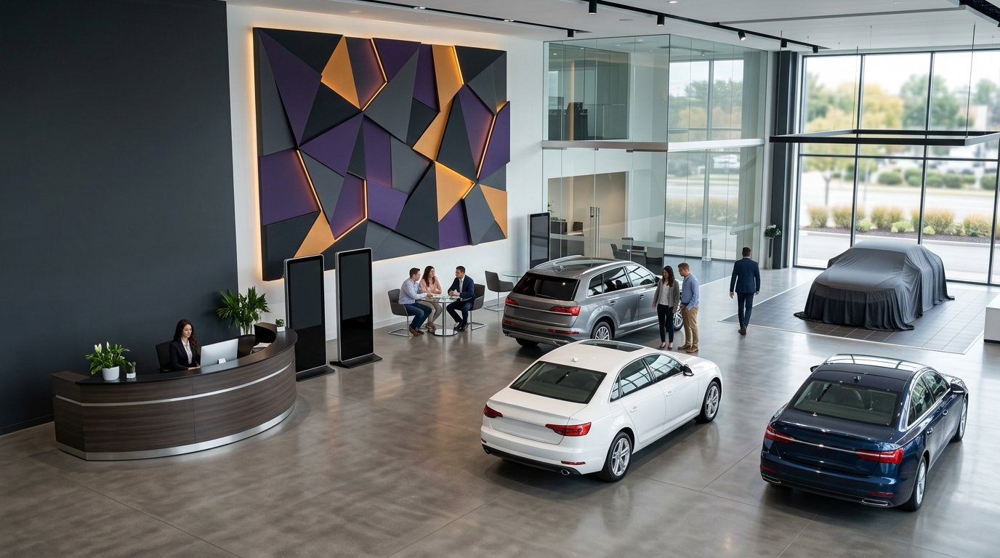
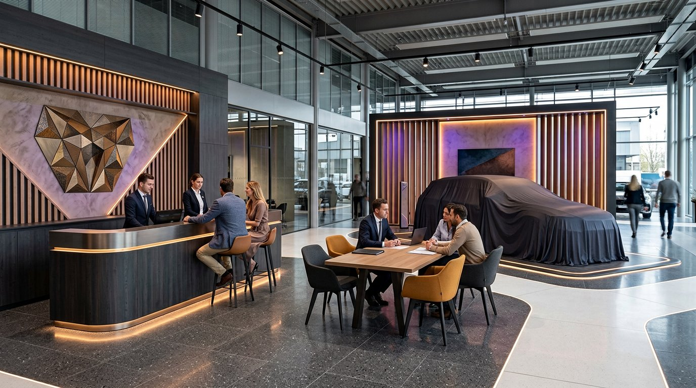
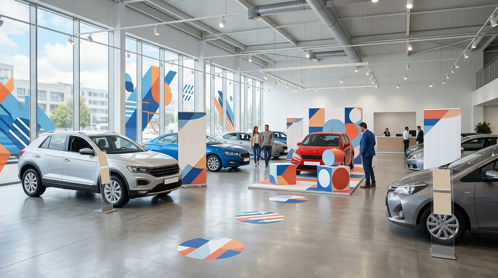
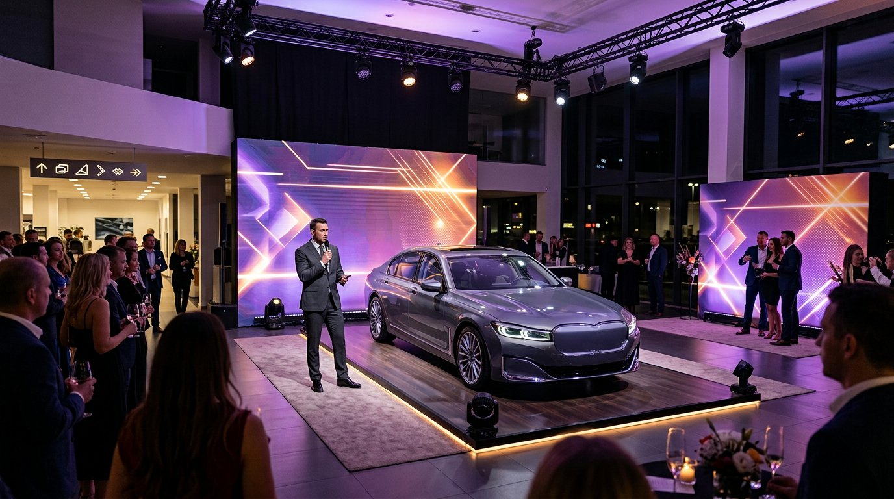
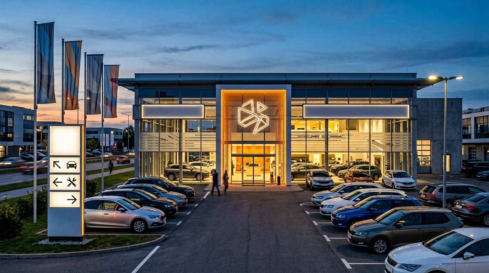
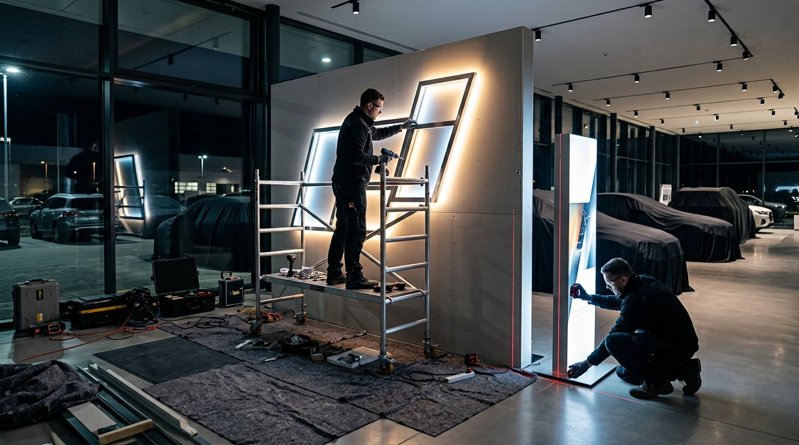

# Оформление автосалонов и дилерских центров

SM Production проектирует, производит и монтирует оформление для автомобильных дилерских центров: от сезонных POS-материалов до ресепшн, зон выдачи, презентаций новых моделей, навигации и фасадных элементов.

Мы объединяем дизайн, печать, производство конструкций, логистику и монтаж в одном проекте. Работы планируем с учётом режима салона, клиентского потока, требований брендбука и даты запуска кампании.

> Для предварительного расчёта достаточно прислать фотографии зоны, примерные размеры, брендбук и дату готовности. Если техническое задание ещё не сформировано, поможем определить состав носителей.

## Какие задачи решаем для автосалонов

Дилерскому центру часто нужен не один рекламный носитель, а согласованное обновление нескольких зон. Витрина должна поддерживать сезонную кампанию, навигация — вести клиента по понятному маршруту, зона консультации — соответствовать стандартам марки, а монтаж — не мешать продажам и сервису.

SM Production подключается к типовым задачам дилерского маркетинга:

- сезонные акции и обновление спецпредложений;
- запуск продаж новой модели;
- оформление презентации, тест-драйва или партнёрского события;
- обновление ресепшн, зоны ожидания и зоны выдачи;
- производство сменных POS-материалов;
- оформление фасада, стекла и территории;
- навигация между шоурумом, сервисом и зоной автомобилей с пробегом;
- тиражирование единого решения на несколько дилерских центров.

## Ресепшн, консультация и зона выдачи

Входная зона формирует первое впечатление, а зона выдачи завершает клиентский путь. Эти пространства должны выглядеть цельно, выдерживать ежедневную эксплуатацию и соответствовать стандартам автомобильной марки.

Для интерьера производим:

- стойки ресепшн и консультационные столы;
- световые и несветовые логотипы;
- фоновые панели и брендированные стены;
- подиумы и декоративные элементы;
- оформление зоны торжественной выдачи;
- таблички, указатели и информационные стенды;
- графику для стеклянных перегородок;
- сменные элементы для кампаний и презентаций.

Материалы и конструктив выбираем после замера. Учитываем существующую отделку, основания, электрику, расположение мебели, требования пожарной безопасности и возможность обслуживания световых элементов.

## Сезонные кампании и POS-материалы

Для акции важно одновременно обновить ключевые точки контакта. Если витрина сообщает одно, стойка рядом с автомобилем — другое, а зона консультации осталась без оформления, кампания выглядит разрозненно.

Мы можем изготовить единый комплект:

- баннеры и сменные полотна;
- Roll Up и мобильные стенды;
- витринную и напольную графику;
- ценникодержатели и информационные стойки;
- POS-дисплеи и промостойки;
- брендирование зоны консультации;
- флаги, виндеры и мобильные уличные конструкции;
- упаковку и маркировку комплектов по адресам.

При работе с сетью дилерских центров формируем спецификацию по каждой площадке. Это уменьшает риск перепутать размеры, количество и адрес доставки.

## Презентация новой модели и события в салоне

Запуск модели превращает работающий шоурум в площадку для события. Здесь нужно совместить требования маркетинга, сценарий мероприятия, размещение автомобилей, свет, поток гостей и ежедневную работу дилерского центра.

В состав оформления могут входить:

- подиум или выделенная зона автомобиля;
- фоновые конструкции и декоративный свет;
- Press Wall, Brand Wall и фотозона;
- стойка регистрации и welcome-зона;
- навигация для гостей;
- объёмная графика и брендированные панели;
- оформление сцены или зоны выступления;
- доставка, монтаж, дежурство и демонтаж.

Состав проекта зависит от количества гостей, доступной площади, высоты помещения, технических возможностей и времени на монтаж. До запуска производства согласуем габариты, материалы, размещение и график работ.

## Фасад, витрины и территория

Наружное оформление помогает обозначить вход, разделить направления и поддержать рекламную кампанию ещё до того, как посетитель окажется внутри.

Производим и монтируем:

- интерьерные и фасадные световые элементы;
- объёмные буквы и панели;
- графику и плёнку для стекла;
- пилоны и указатели движения;
- флаги и виндеры;
- временные баннерные конструкции;
- оформление входной группы.

Перед расчётом наружной конструкции проверяем основание, способ крепления, электроподключение, доступ для монтажа и условия эксплуатации. Постоянные фасадные решения могут потребовать отдельной проверки согласований со стороны владельца здания или заказчика.

## Монтаж без лишнего простоя

Дилерский центр не должен останавливать продажи из-за обновления оформления. Поэтому график монтажа согласуем заранее: часть работ можно выполнить поэтапно, до открытия или после закрытия.

До выезда уточняем:

- правила доступа и пропускной режим;
- место разгрузки и временного хранения;
- необходимость защиты пола, мебели и автомобилей;
- допустимость шумных и пыльных работ;
- доступ к электропитанию;
- последовательность открытия и закрытия зон;
- ответственного представителя на объекте.

Комплекты маркируем по помещениям или адресам. После монтажа проверяем геометрию, подключение световых элементов, устойчивость конструкций и комплектность.

## Как проходит работа

1. **Экспресс-аудит.** Получаем фотографии, план или видео. Уточняем маркетинговую задачу, адрес и дату запуска.
2. **Замер и бриф.** Проверяем размеры, основания, электрику, клиентские маршруты и ограничения объекта.
3. **Концепция.** Адаптируем брендбук, определяем набор носителей и показываем решение до производства.
4. **Смета и график.** Фиксируем материалы, количество, сроки, доставку и последовательность монтажных работ.
5. **Производство.** Печатаем графику, изготавливаем конструкции, собираем и маркируем комплекты.
6. **Доставка и монтаж.** Устанавливаем оформление в согласованное время и сдаём готовый объект.

## Три удобных формата старта

### Сезонное обновление

Для кампании, которую нужно быстро запустить в шоуруме: сменная графика, Roll Up, POS, витрины, напольные элементы и навигация.

### Презентация модели

Для запуска продаж или клиентского события: подиум, презентационный фон, фотозона, регистрация, навигация и декоративные конструкции.

### Обновление пространства

Для постоянных зон: ресепшн, световые логотипы, брендированные стены, зона выдачи, интерьерная навигация и фасадные элементы.

Каждый формат рассчитывается после проверки реального объёма работ. Готовые пакетные цены без замера могут не учитывать размеры, материалы, электрику, логистику и условия монтажа.

## Что прислать для предварительного расчёта

- фотографии или короткое видео зоны;
- план помещения или примерные размеры;
- брендбук и макеты, если они есть;
- список желаемых носителей;
- количество дилерских центров;
- дату запуска кампании или мероприятия;
- адрес и условия доступа;
- удобное время для монтажа.

Если материалов немного, начните с фотографии и даты. Мы зададим уточняющие вопросы и предложим следующий шаг.

## Частые вопросы

### Можно обновить оформление без остановки работы салона?

Во многих проектах — да. Работы делим по зонам и планируем на часы с минимальным потоком, до открытия или после закрытия. Точный график зависит от конструкций и правил объекта.

### Вы работаете по брендбуку автомобильной марки?

Да. Проверяем фирменные цвета, шрифты, охранные поля и правила использования логотипа. Макеты согласуются до производства.

### Можно оформить несколько дилерских центров?

Да. Формируем спецификации по адресам, маркируем комплекты и составляем график логистики. Срок подтверждаем после проверки количества площадок.

### Можно заказать только сезонные материалы?

Да. Можно изготовить баннеры, мобильные стенды, витринную графику, POS и навигацию без комплексного обновления интерьера.

### Сколько стоит оформление автосалона?

Цена зависит от площади, количества носителей, материалов, электрики, логистики и монтажа. Для предварительной оценки нужны фотографии, размеры, брендбук и дата.

## Заказать консультацию

Оставьте имя и телефон — менеджер свяжется с вами в рабочее время, уточнит задачу и согласует следующий шаг. Для содержательного разговора полезно заранее подготовить фотографию зоны, ориентировочные размеры и желаемую дату готовности, но полное техническое задание на первом этапе не обязательно.

Телефон: **+7 (495) 799-00-19**
Почта: **sm-pro1@yandex.ru**
Сайт: **sm-production.ru**

*Интерьерные изображения на странице являются концепт-визуализациями и показывают возможные направления оформления. Финальный результат определяется после замера и согласования проекта.*
