# Печать на ПВХ и изделия из ПВХ

**Брендированные панели, ростовые фигуры, навигация и POS-материалы — от дизайна SM Production до готового изделия и монтажа.**

Листовой вспененный ПВХ — лёгкий и жёсткий материал для интерьерной рекламы, оформления мероприятий и временной навигации. На него можно наносить полноцветное изображение, оклеивать плёнкой, вырезать сложный контур и устанавливать на стену, дистанционные держатели или напольную опору.

SM Production берёт весь процесс в одни руки: уточняет задачу, разрабатывает дизайн, подбирает материал и технологию печати, готовит производственные файлы, печатает, вырезает детали, комплектует креплением и доставляет готовый набор на площадку.

**CTA:** Получить расчёт по размерам и тиражу

## Что мы изготавливаем из ПВХ

### Брендированные панели

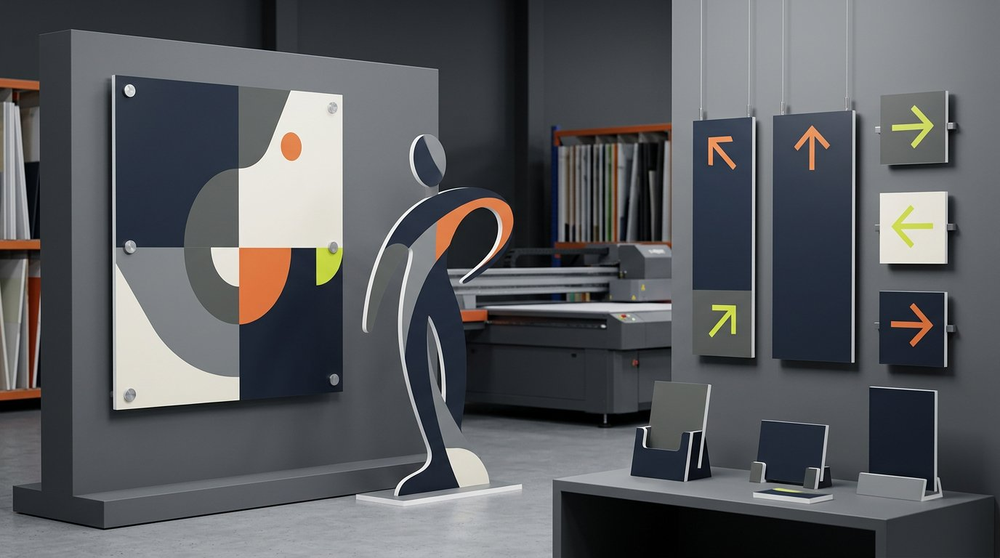

Плоские и фигурные панели для оформления стен, стоек регистрации, витрин, фотозон, презентационных пространств и выставочных стендов. Изображение наносится непосредственно на лист или печатается на самоклеящейся плёнке с последующей накаткой.

Панель можно установить:

- непосредственно на поверхность;
- на дистанционные держатели;
- в раму или подготовленную нишу;
- на скрытый крепёж;
- на временную монтажную систему для мероприятия.

### Ростовые фигуры

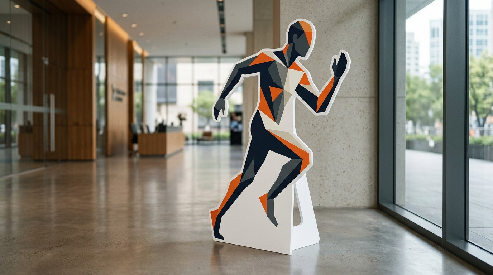

Изготавливаем фигуры людей, персонажей, продуктов, талисманов и брендированных объектов. Изображение печатается в нужном масштабе, а лист вырезается по подготовленному векторному контуру.

Для каждой фигуры отдельно проектируем устойчивость. Это может быть задняя распорка, широкое напольное основание или другой конструктив с учётом высоты изделия, потока посетителей и места установки.

Ростовые фигуры подходят для:

- фотозон и бренд-зон;
- промоакций и презентаций;
- витрин и торговых точек;
- выставочных стендов;
- навигации внутри события;
- оформления детских и тематических мероприятий.

### Навигация из ПВХ

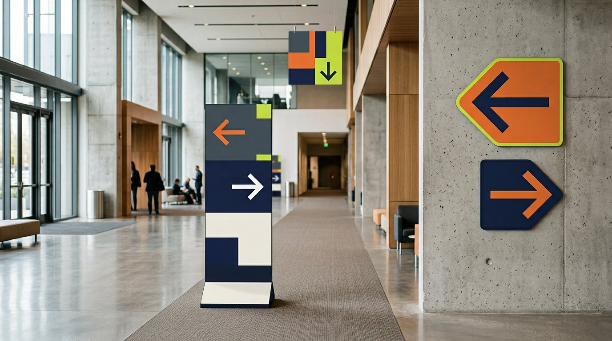

Производим единую систему указателей для конференций, выставок, офисов, фестивалей и корпоративных событий. В комплект могут входить:

- навигационные стрелки;
- номера залов и зон;
- таблички регистрации и гардероба;
- расписание и программа;
- настенные указатели;
- подвесные маркеры;
- напольные информационные тотемы;
- таблички на дистанционных держателях.

При разработке навигации учитываем расстояние просмотра, высоту установки, движение потока людей, контраст и последовательность обозначений. Хорошая навигация должна считываться за несколько секунд, а не просто повторять фирменный стиль.

### POS-материалы и рекламные элементы

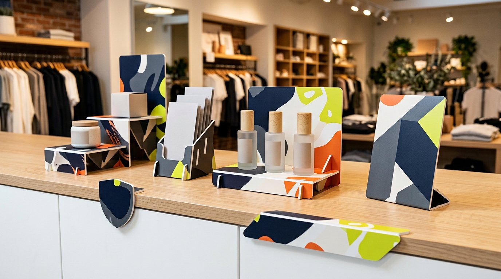

Из ПВХ можно изготовить ценники, меню, шелфтокеры, стопперы, дисплеи, декоративные вставки, таблички для витрин и элементы промостоек. Для серии изделий подготавливаем единый шаблон, чтобы тираж выглядел последовательно и аккуратно.

## Почему выбирают вспененный ПВХ

ПВХ сочетает небольшой вес, достаточную жёсткость и широкие возможности обработки. Он удобен для проектов, где нужно быстро получить готовые рекламные изделия без тяжёлого металлического или деревянного каркаса.

Основные преимущества:

- подходит для прямой УФ-печати;
- оклеивается цветной и печатной плёнкой;
- режется по прямому или фигурному контуру;
- позволяет создавать единичные изделия и серии;
- легко комплектуется опорами и крепежом;
- подходит для временного интерьерного оформления;
- доступен в разных толщинах.

Материал не является универсальной заменой для любых условий. Для постоянной улицы, высокой механической нагрузки или крупной самонесущей конструкции могут потребоваться композит, акрил, металл или дополнительный каркас.

## Какую толщину ПВХ выбрать

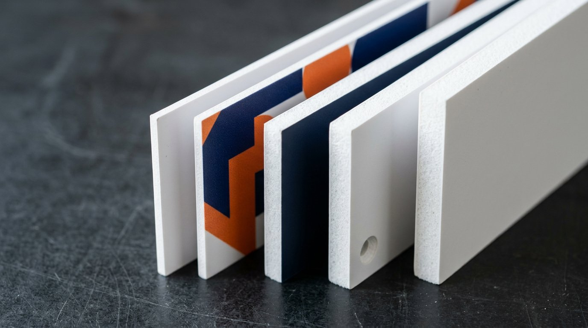

Толщина зависит от размера, формы, способа установки и требуемой жёсткости. Универсального значения для всех изделий нет.

| Ориентир | Типичные задачи |
|---|---|
| 2–3 мм | Небольшие таблички, накладки, ценники и элементы, которые крепятся на основу |
| 5 мм | Навигация, панели среднего размера, большинство интерьерных фигур |
| 8–10 мм | Крупные фигуры, напольные изделия и детали, которым нужна повышенная жёсткость |

Это не готовая спецификация. Для высокой или узкой фигуры важны не только миллиметры листа, но и геометрия, центр тяжести, основание и способ крепления.

## Прямая УФ-печать или оклейка плёнкой

### Прямая УФ-печать

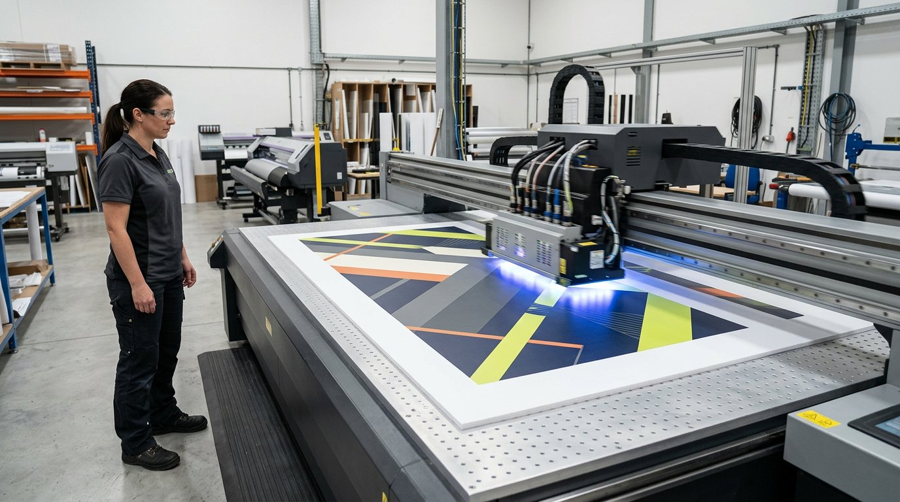

Изображение наносится непосредственно на лист и закрепляется ультрафиолетом. Метод подходит для полноцветных изображений, единичных изделий и небольших серий.

Преимущества:

- не требуется отдельная накатка изображения;
- можно печатать сложную полноцветную графику;
- поверхность готова к последующей контурной резке;
- удобно выпускать комплект изделий в одном дизайне.

### Печать на самоклеящейся плёнке

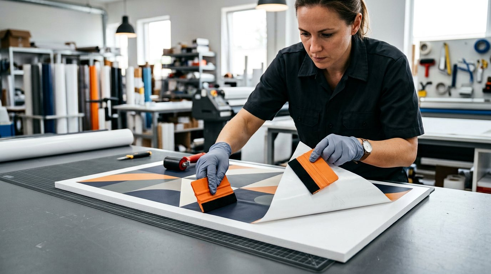

Изображение сначала печатается на плёнке, затем накатывается на лист ПВХ. При необходимости добавляется защитная ламинация.

Метод выбирают, когда важны свойства конкретной плёнки, дополнительная защита поверхности или возможность технологически разделить печать и сборку.

### Плоттерная графика

Для простых надписей, стрелок и цветовых полей можно использовать цветные самоклеящиеся плёнки, вырезанные по векторному контуру. Такой способ хорошо работает в лаконичной навигации и при небольшом количестве цветов.

Технологию определяем после просмотра макета, тиража и условий эксплуатации. Иногда в одном комплекте рационально объединить несколько методов.

## Дизайн от SM Production

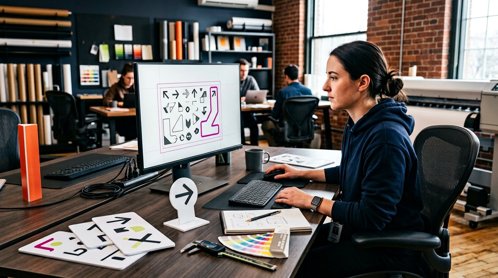

Если готового макета нет, команда SM Production разработает визуальную систему с учётом фирменного стиля и реального производства.

Мы можем подготовить:

- дизайн отдельной ростовой фигуры;
- серию навигационных носителей;
- макеты брендированных панелей;
- пиктограммы и цветовое кодирование зон;
- набор POS-материалов;
- адаптацию ключевого визуала под разные форматы;
- файлы для печати, резки и сборки.

Дизайнер работает вместе с производством. Поэтому ещё на этапе макета учитываются:

- размер листа и изделия;
- линия контурной резки;
- безопасные поля;
- минимальная толщина выступающих деталей;
- положение опоры и крепежа;
- расстояние просмотра;
- читаемость текста;
- стыки, если изделие крупнее рабочего формата.

Такой подход помогает избежать ситуации, когда красивый макет нельзя безопасно вырезать или установить.

## Где используются изделия из ПВХ

### Мероприятия

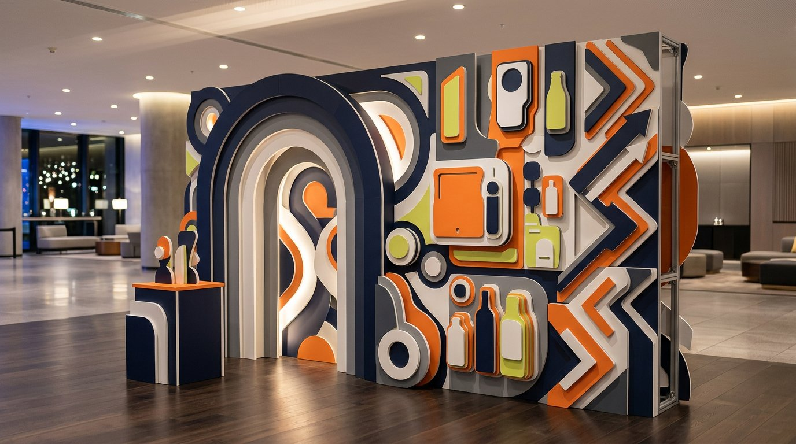

Навигация, расписание, номера зон, ростовые фигуры, декор фотозоны, таблички регистрации и информационные панели.

### Выставки

Графические вставки, фигуры продуктов, настенные панели, POS-материалы и указатели внутри стенда.

### Офисы и шоурумы

Интерьерные таблички, брендированные стены, временные информационные панели и навигация.

### Ритейл и промо

Меню, ценники, дисплеи, стопперы, промостойки и фигурные изображения продуктов.

### Фотозоны

Фигурные элементы, реквизит, объёмные композиции из нескольких слоёв и напольные персонажи.

## Как проходит работа

1. **Получаем задачу.** Уточняем размеры, тираж, дату, место установки и срок использования.
2. **Разрабатываем или проверяем дизайн.** Проверяем масштаб, качество изображений, шрифты, цвета и контур реза.
3. **Подбираем технологию.** Определяем толщину ПВХ, способ печати, защиту, кромку, опоры и крепление.
4. **Согласовываем макет.** Перед запуском заказчик получает финальный вид и техническую спецификацию.
5. **Производим.** Печатаем, режем детали, обрабатываем кромку и собираем конструктив.

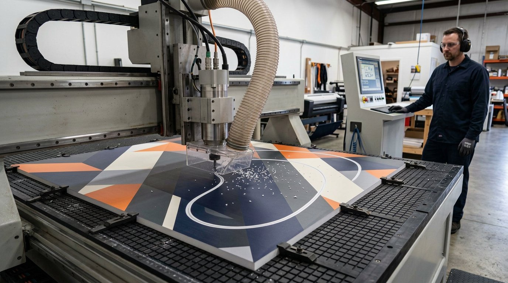
6. **Проверяем.** Контролируем цвет, геометрию, комплектность и устойчивость напольных изделий.
7. **Упаковываем и маркируем.** Если комплект состоит из нескольких зон, разделяем изделия по местам установки.
8. **Доставляем и монтируем.** При необходимости выполняем установку и сдаём готовое оформление.

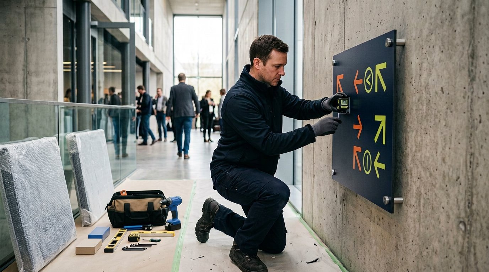

## Требования к макету

Для предварительной оценки достаточно прислать изображение, размеры и описание задачи. Для производства предпочтительны:

- PDF, AI или EPS;
- векторный контур реза отдельным цветом или слоем;
- шрифты, переведённые в кривые;
- изображения в достаточном разрешении для итогового размера;
- цветовая модель CMYK;
- приложенный брендбук и эталоны цвета, если они важны;
- указание лицевой стороны, мест крепления и необходимых отверстий.

Точные требования зависят от способа печати и конструкции. Перед запуском мы проверяем файл и сообщаем, если нужна доработка.

## От чего зависит стоимость

Цена складывается из нескольких параметров:

- количества и размеров изделий;
- толщины и типа ПВХ;
- площади печати;
- прямой печати или оклейки плёнкой;
- сложности контура;
- количества внутренних вырезов;
- ламинации и другой защиты;
- вида опоры или крепления;
- упаковки и маркировки;
- доставки и монтажа.

Для точного расчёта пришлите размеры, тираж, дату и референс. Если конструкции ещё нет, достаточно описать задачу — мы предложим материал и способ установки.

## Частые вопросы

### Какую толщину ПВХ выбрать для ростовой фигуры?

Толщина зависит от высоты, ширины, формы и опоры. Для фигуры человеческого роста часто рассматривают лист средней или повышенной толщины, но окончательное решение принимается после проверки геометрии и устойчивости.

### Можно ли напечатать белый цвет?

Возможность белой подложки зависит от выбранной технологии и оборудования. Она может понадобиться для цветных или прозрачных материалов, но для стандартного белого вспененного ПВХ белые участки обычно формируются самим цветом листа.

### Можно ли сделать двустороннюю фигуру?

Да, если конструкция и опора рассчитаны на двустороннее изображение. Для такого изделия отдельно согласуем совмещение сторон и обработку кромки.

### Делаете ли вы дизайн с нуля?

Да. Можно прислать брендбук, логотипы, тексты и референсы. Дизайнер SM Production подготовит концепцию и производственные макеты.

### Подходит ли ПВХ для улицы?

Для краткосрочных проектов — в отдельных случаях. Нужно оценить температуру, осадки, ультрафиолет, ветер и способ крепления. Для постоянной улицы часто рекомендуются другие материалы.

### Можно ли изготовить один экземпляр?

Да. Технология подходит и для единичных изделий, и для серий. При большом тираже отдельно оцениваем раскладку на листе и повторяемость цвета.

### Выполняете ли вы монтаж?

Да. Можем изготовить только продукцию или взять доставку и монтаж на себя. Состав работ фиксируется в смете.

## Заказать печать и изделия из ПВХ

Пришлите размеры, количество, дату и пример желаемого результата. Если макета нет, команда SM Production разработает дизайн и подготовит изделие к производству.

**CTA:** Рассчитать проект
